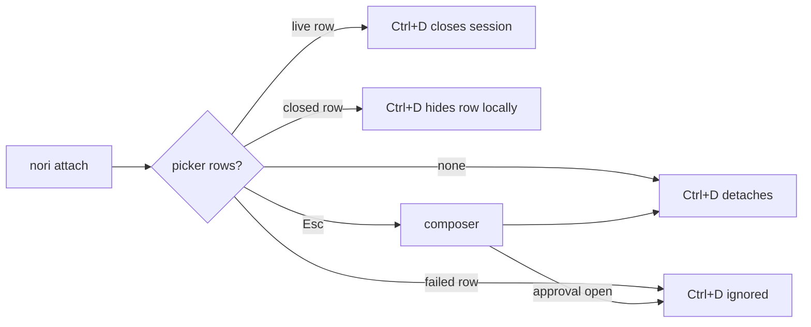

# Host audit: five everyday goals with `nori host` + `nori attach`

Audit only. No product code changed.

## What was run

| Item | Value |
|---|---|
| Binary | npm `nori-ai-cli@0.30.0-next.15` (`next` dist-tag), linux-musl x86_64, sha256 `7361e9ea…3a44` |
| Source | `nori-v0.30.0-next.15` = main `214d79b0885b6a0e49e2823dce7829bcb350755b` plus the release commit (only `nori-rs/Cargo.toml` version changes). `latest` is `0.30.0`. |
| Agents | Synthetic Lantern ACP servers (`harness/lantern_adapter.py`, copied from `nori/host-tui-acceptance`) as `claude-code`, `codex`, `opencode`. No real provider, no credentials. |
| Isolation | Fresh `NORI_HOME`/`HOME` per run under `/tmp`, background host on `127.0.0.1:7420`. |
| Terminals | Real tmux PTYs, 120x36, two to four terminals per run. |
| Platform | Linux (Modal VM). macOS untested. |

Repeat: `harness/audit/run.sh <nori binary> <out dir>` (needs tmux and python3).
It prints `OBSERVED`/`DIFFERS` per check. The run committed under
`results/harness-run/` reproduced 23/23. `results/exploratory/` holds the
manual session captures cited below (`.txt` plain, `.ansi` colored).

## Verdict

| # | Goal | Verdict | Why |
|---|---|---|---|
| 1 | Start or find a host and attach from a fresh terminal, incl. zero sessions | Partial | `nori host`, `nori attach`, `nori host ls` work. Plain `nori` silently ignores a running host. Empty picker copy is developer text. TTY `host ls` has no IDs. |
| 2 | Choose or change an agent, get a first usable session | Fail (hidden workaround) | `/agent`, `/model`, `/config`, `/resume` are greyed in attach. `/agents` goes to the agent as a prompt. `/new <agent>` works but nothing in the UI says so; root `--agent` is ignored. |
| 3 | One real task: send, stream, approve or cancel | Pass | Prompt, live streaming, approve with `y`, Esc and Ctrl+C cancel all work. Minor copy and ordering issues. |
| 4 | Several sessions and terminals | Partial | Second session, list, Alt+S switch, watch, Alt+T takeover work. A watcher's refused keypress hides the approval from it for good, so after takeover the turn stalls. Saved sessions are not reachable. |
| 5 | Leave and return safely | Fail | Ctrl+D in the picker closes a live session without asking, or does nothing on a failed row. Ctrl+D does nothing while an approval is open. `host stop` drops every session from the host. |

## Cliff's two reports

**`/agents`** (reproduced). `/agents` is not a command in either TUI. In
attach it is sent as a prompt: with no session it fails with "No session is
open on this host. Pick one with /sessions." (`r1/g2-agents-enter`); in a
session the agent receives the literal text `/agents` (`r2/n4-agents-in-session`).
The advertised `/agent` is greyed: "not available in nori attach yet"
(`r1/g2-slash-menu`). Plain `nori` has a working `/agent` picker, and choosing
an agent there reaches a reply (`r1/g2-plain-agent`).

**Detach with no active agent** (reproduced in two states; the plain empty case works).

| State | Ctrl+D | Evidence |
|---|---|---|
| Picker, zero rows | Detaches | `harness-run/s1-zero/cap/empty-picker-ctrl-d` |
| Composer after Esc, no session | Detaches | `…/composer-ctrl-d` |
| Composer, session failed to start | Detaches | `r2/n1-ctrld-badagent` |
| Composer, session still starting | Detaches | `r2/n2-ctrld-starting` |
| Picker, failed row selected | **Nothing, any number of presses.** Footer says `ctrl+d close`. | `…/s4-failed/cap/failed-picker-5x-ctrl-d` |
| Picker, live row selected | **Closes that session**, no confirmation (agent gets `session/close`) | `…/s1-zero/cap/picker-ctrl-d-count` |
| Picker, closed row | "remove": hides it in this client only; it is back on the next attach | `r1/g5-picker-ctrld-1`, `r1/g5-after-kill-picker` |
| Approval overlay open | **Nothing**; footer still says `ctrl+d detach` | `…/s5-approve/cap/controller-ctrl-d-overlay` |

The host survived every case (`nori host ls` answered afterward).
When the default agent cannot start, `nori attach` opens the picker with a
failed row on top, so Ctrl+D appears broken. That matches "can't detach when
you don't have active agent sessions".

## Findings, by impact

Each: expected / actual / workaround (verified unless noted) / classification.

1. **Ctrl+D in the session picker is not detach** (goal 5, 1).
   Expected: Ctrl+D leaves the TUI everywhere, as the footer and plain `nori` teach; closing a live session asks first or uses another key.
   Actual: see the table above. On reattach the cursor starts on the oldest row, not the session you left (`…/s5-approve/cap/reattach-picker`), so a Ctrl+D reflex closes whatever is first.
   Workaround: Esc, then Ctrl+D or `/detach`.
   Class: close-on-Ctrl+D is documented in `docs/tui.md` (deliberate but harmful); the no-op on failed rows and the non-persistent "remove" are bugs.

2. **No discoverable way to choose the agent in attach** (goal 2).
   Expected: `/agent` lists agents and starts or switches to one; the host's agents are visible.
   Actual: `/agent` greyed; `/new` row says only "start a new chat during a conversation"; `/new <agent>` and `/new <folder> <agent>` work (`…/s1-zero/cap/new-codex`) but have no hint, list, or completion; a typo creates a failed session that stays in the list (`…/new-typo`). `nori --agent opencode attach` then `/new` starts `claude-code` (`…/root-agent-flag`), though `docs/commands.md` says root `--agent` applies to attach.
   Workaround: `/new <slug>` in attach, or `nori host new --agent <slug>` then Alt+S.
   Class: `/agent` disabled is a known gap ("not available yet"); `--agent` ignored is a doc/behavior mismatch.

3. **Approval lost after a watcher touches it** (goal 4, 3).
   Expected: the watcher's overlay is visibly read-only; whoever takes control sees the pending approval.
   Actual: the watcher sees "Allow once (y)". Pressing `y` is refused ("watcher is read-only") but closes its overlay and prints "Permission: Allow once …" in its transcript. After Alt+T that terminal shows "waiting on you" with no overlay; the old controller (now a watcher) still shows one it cannot answer. The turn stalls (`…/s5-approve/cap/watcher-took-control`, `r2/p1-*`).
   Workaround: a fresh `nori attach <id>` plus Alt+T shows the approval (`…/fresh-attach-overlay`).
   Class: controller-only approvals are deliberate; the lost overlay is a bug.

4. **Ctrl+D ignored while an approval is open** (goal 5).
   Expected: detach and leave the approval pending for later, or a hint saying why not.
   Actual: no effect; footer still says `ctrl+d detach`. Ctrl+C rejects the request as `cancelled` (ledger) and then offers "ctrl + c again to quit".
   Workaround: answer first, or Ctrl+C twice (this cancels the request).
   Class: untested in docs; bug or missing hint.

5. **Saved sessions unreachable from the host** (goals 4, 5).
   Expected: one list that tells live host sessions from saved ones and resumes either onto the host, including the agent's own saved sessions.
   Actual: `/resume` greyed in attach. The Lantern agent advertises `session/list` and `loadSession`; the host calls `session/list`, but its saved "Saved orchard survey" never appears, from either folder (`r2/s1-attach-from-beta`). A closed session opens read-only and rejects prompts with "session is not running" (`r1/g4-b-closed-send`). Ctrl+R "resume" on a failed row fails: "has no transcript to resume from". After `nori host stop` and restart the host lists nothing (`…/host-ls-after-restart.txt`).
   Workaround: `nori resume` lists them, but on a private host, so other terminals can't attach (`…/resume-after-stop`). Its list shows IDs, not titles.
   Class: known gap (`/resume` "not available yet"); conflicts with the project rule that choosing an agent server must allow resuming its saved sessions.

6. **Host discoverability** (goal 1).
   - Plain `nori` with a background host running starts a private host and says nothing about the running one (`r1/g1-plain-nori`). Documented, but the user can't tell which mode they're in.
   - `nori host ls` on a terminal prints titles but no IDs; `nori attach <id>` needs one. Piped output does show an ID column (`r1/g4-host-ls-two` is the terminal view). Zero sessions prints only a header.
   - The empty picker says "No options available / The caller has not supplied any rows." with no `/new` hint (`…/empty-picker`).
   - The composer gives two different instructions: "Use /new to start one" and "Pick one with /sessions" (`r1/g2-agents-enter`).
   - `?` in attach lists plain-TUI keys ("ctrl + c to exit") and none of Alt+S, Alt+T, Ctrl+D detach, `/new`, `/close` (`r2/n4-help`).
   - Detaching prints nothing about how to return; plain `nori` prints a resume command.
   - The welcome line says "(/config to change)" while `/config` is greyed.

7. **`nori host stop` while attached** (goal 5).
   Expected: attached terminals say the host was stopped.
   Actual: they show "Lost the connection … Reconnecting; your draft is kept." and `RECONNECTING` until a new host starts, then "Host restarted; sessions were lost." (`…/after-host-stop`, `…/after-host-restart`).
   Class: documented reconnect behavior; the message is misleading for a deliberate stop.

8. **One host port per machine.** Every host binds `127.0.0.1:7420`. When it is taken, a host in another `NORI_HOME` fails with "host exited before publishing readiness: early eof" and an empty `host.log`. Seen once during harness development; not in the committed run.

9. **Minor (goal 3).**
   - The "Permission: Allow once …" record prints above the prompt it belongs to (`r1/g3-perm-approved` scrollback).
   - A user Esc interrupt prints "Something went wrong? Report the issue at …".
   - Reattaching mid-turn restarts the turn timer at 0 s.

## Close, stop, detach (as observed)

| Action | Effect |
|---|---|
| Ctrl+D or Ctrl+C on an empty composer, `/detach` | This terminal leaves; sessions and turns keep running (`r1/g5-reattach-busy`, `r1/g5-reattach-midstream`) |
| Killing the terminal | Same as detach |
| `/close`, picker Ctrl+D on a live row | `session/close` to the agent; the row stays as `closed` and can't take prompts |
| `nori host stop` | Every session ends; the host lists none after restart; Nori's stored transcripts remain for `nori resume` |

## Deliberate restrictions (not counted as bugs)

- One controller per host, not per session; later terminals start as watchers, and a second terminal can't drive a different session at the same time (host contract).
- Only the controller prompts, starts sessions, or answers approvals; no auto-promotion when the controller leaves.
- `!` shell only for a local controller.

## Not tested

- Real hosted agents (Claude Code, Codex, Gemini, Grok) and their real saved sessions.
- Remote `--host`/`--token-file`, Sessions broker, Zed, macOS, mixed versions.
- `/screen`, `/delegate`, queue/steer, `@` completion, `/approvals` changes.
- The CLI was not built from source; `next.15` is main plus a version bump.
