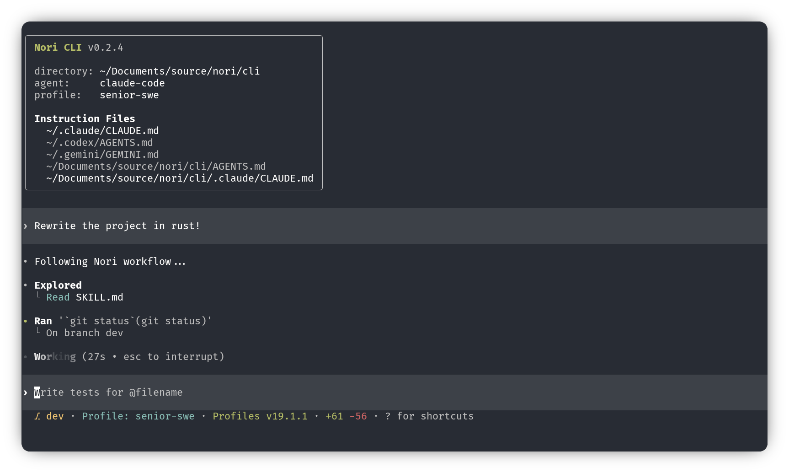

# Nori CLI

[](https://github.com/tilework-tech/nori-cli/actions/workflows/rust-ci.yml)
[](https://www.npmjs.com/package/nori-ai-cli)
[](https://github.com/tilework-tech/nori-cli/blob/main/LICENSE)

Nori runs coding agents in one terminal. It starts Claude Code, Codex,
Antigravity, Grok Build, OpenCode, Cursor Agent, Hermes Agent, Pi, or your own
ACP agent, and drives it over the
[Agent Client Protocol](https://agentclientprotocol.com). The agent keeps its
own tools, settings, and sign-in.



## Install

```bash
npm install -g nori-ai-cli
```

Bun works too: `bun install -g nori-ai-cli`. The package needs Node.js 16 or
later. It contains a native `nori` binary for each supported platform.

You can also download an archive from
[GitHub Releases](https://github.com/tilework-tech/nori-cli/releases/latest).
Each archive holds one binary at `nori/nori`.

## Supported platforms

| OS | Architecture | npm | Release archive |
|---|---|---|---|
| Linux (static musl) | x86_64 | yes | `nori-<version>-linux-x86_64.tar.gz` |
| Linux (static musl) | arm64 | yes | `nori-<version>-linux-arm64.tar.gz` |
| macOS | Apple silicon | yes | `nori-<version>-darwin-arm64.tar.gz` |
| macOS | Intel | yes | `nori-<version>-darwin-x86_64.tar.gz` |

Windows and Android have no release build. `nori host` and `nori attach` need
Unix file permissions.

## Update

```bash
npm install -g nori-ai-cli@latest
```

When a newer stable release exists, Nori offers to run this command at startup
(with `bun` if Bun installed it). To try the newest build from `main`, install
the `next` channel:

```bash
npm install -g nori-ai-cli@next
```

Channels and version numbers: [docs/release-artifacts.md](docs/release-artifacts.md).

## Quick start

```bash
nori                          # open the TUI with the default agent (claude-code)
nori --agent codex            # pick an agent
nori "explain this repo"      # start with a prompt
nori resume                   # reopen an earlier session
nori exec "fix the failing test"   # run one prompt without the TUI
nori auth                     # see which agents are signed in
```

Inside the TUI, type `/` for commands and `?` for keyboard shortcuts.
`/agent` switches agents.

## Surfaces

| Surface | What it does | Docs |
|---|---|---|
| `nori` | Interactive terminal UI. Runs many sessions at once. | [docs/tui.md](docs/tui.md) |
| `nori exec` | Runs one prompt headlessly and exits. | [docs/commands.md](docs/commands.md) |
| `nori host`, `nori attach` | Runs sessions in a background host. Terminals attach and detach without stopping work. | [docs/tui.md](docs/tui.md#attach-from-a-second-terminal) |
| `nori cloud` | The TUI connected to a Nori Sessions machine. | [docs/tui.md](docs/tui.md#nori-cloud) |
| `nori auth` | Sign-in status and saved API keys. | [docs/auth.md](docs/auth.md) |

More reference:

- Agents, IDs, and custom ACP agents: [docs/agents.md](docs/agents.md)
- Every command and flag: [docs/commands.md](docs/commands.md)
- `config.toml`: [docs/configuration.md](docs/configuration.md)
- Approvals and sandboxing: [docs/permissions.md](docs/permissions.md)
- MCP servers: [docs/mcp.md](docs/mcp.md)
- Files Nori writes: [docs/storage.md](docs/storage.md)
- Terms: [GLOSSARY.md](GLOSSARY.md)

## Attribution

Nori CLI is built on [OpenAI Codex CLI](https://github.com/openai/codex) and
the [ACP project](https://github.com/agentclientprotocol/agent-client-protocol).

## License

[Apache-2.0](LICENSE)
