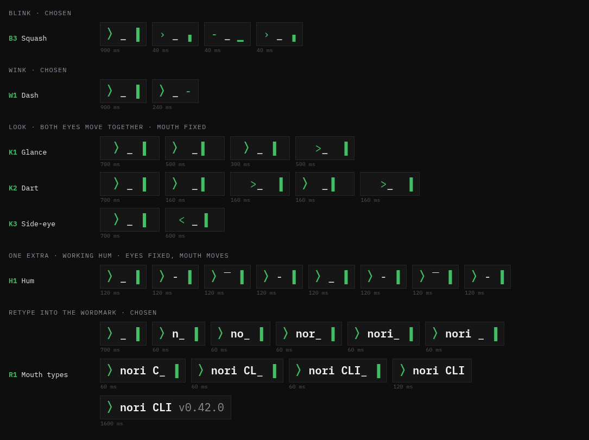
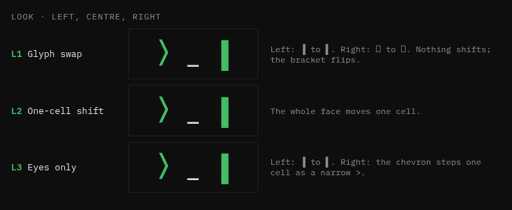
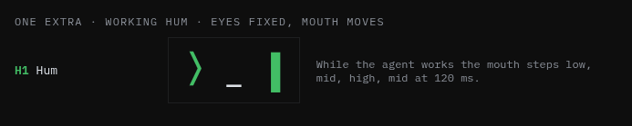

# Nori CLI face: study 03

Design study only. Nothing here changes product code. All content is synthetic.

- Face: `〉_ ▐`. Both eyes are green. The mouth is the default foreground.
- Wordmark: `〉nori CLI` followed by a dim version string.
- `〉` is U+3009 RIGHT ANGLE BRACKET. It takes 2 terminal cells, so the face is 5 cells.

Open `index.html` to play every option (speed, size, all-frames view).
`frames.txt` holds the same frames as plain text.

Chosen by Cliff: blink B3 (squash), wink W1 (dash), retype R1 (mouth types).

| Open | Options | Preview |
|---|---|---|
| Look: both eyes move together, mouth fixed | K1 glance, K2 dart, K3 side-eye |  |
| One extra: working hum | H1 |  |

## Notes

- Every option changes glyphs in place. No frame changes the width of the cells it uses,
  except the retype, which grows to the wordmark.
- `〉` cannot sit in the cell next to the mouth on the right-look frame, because it is 2 cells
  wide. That frame uses the 1-cell `>`, which is smaller.
- `▗` and `▁` need a font with block elements. `-`, `·` and `_` are the safe choices.
- Earlier studies are in this branch's history.
