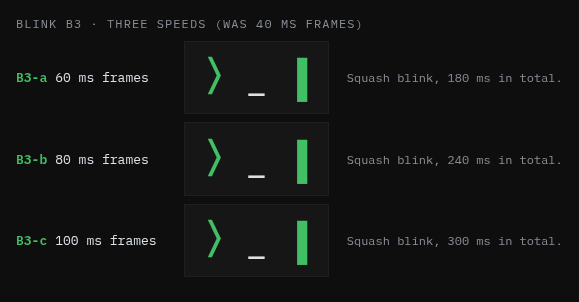
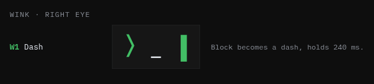

# Nori CLI face and wordmark

Design study only. Nothing here changes product code. All content is synthetic.

- Face: `〉_ ▐`. Both eyes are green. The mouth is the default foreground.
- Wordmark: `〉nori CLI` followed by a dim version string.
- `〉` is U+3009 RIGHT ANGLE BRACKET. It takes 2 terminal cells, so the face is 5 cells.

Open `index.html` to play the animations (speed, size, all-frames view).
`frames.txt` holds the same frames as plain text.

## Chosen by Cliff

| Animation | Frames | Timing | Preview |
|---|---|---|---|
| Blink (B3, squash) | `〉_ ▐` `› _ ▗` `- _ ▁` `› _ ▗` | 80 ms per frame |  |
| Wink (W1, dash) | `〉_ ▐` `〉_ -` | dash holds 240 ms |  |
| Retype into the wordmark (R1) | the underscore types `nori CLI` and pushes the right eye along | 60 ms per letter |  |

## Dropped

- Looking left and right. A look must move both eyes in the same frame with the mouth
  still, and no option tried so far looked right.
- A working hum on the mouth.

## Notes

- Blink and wink change glyphs in place and never change the 5-cell width.
- `▗` and `▁` need a font with block elements.
- Earlier studies are in this branch's history.
