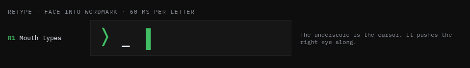

# Nori CLI face: study 02

Design study only. Nothing here changes product code. All content is synthetic.

- Face: `〉_ ▐`. Both eyes are green. The mouth is the default foreground.
- Wordmark: `〉nori CLI` followed by a dim version string.
- `〉` is U+3009 RIGHT ANGLE BRACKET. It takes 2 terminal cells, so the face is 5 cells.

Open `index.html` to play every option (speed, size, all-frames view).
`frames.txt` holds the same frames as plain text.

| Group | Options | Preview |
|---|---|---|
| Blink, both eyes | B1 dash, B2 dot, B3 squash, B4 flat |  |
| Wink, right eye | W1 dash, W2 squash, W3 underscore |  |
| Look left and right | L1 glyph swap, L2 one-cell shift, L3 eyes only |  |
| Retype into the wordmark | R1 mouth types, R2 eye types, R3 overwrite |  |

## Notes

- Every option changes glyphs in place. No frame changes the width of the cells it uses,
  except the retype, which grows to the wordmark.
- `〈` (U+3008) is drawn in the right cell of its pair and `〉` in the left, so swapping
  them moves the eye one cell and flips it.
- `▗` and `▁` need a font with block elements. `-`, `·` and `_` are the safe choices.
- Study 01 (a different face) is in this branch's history.
