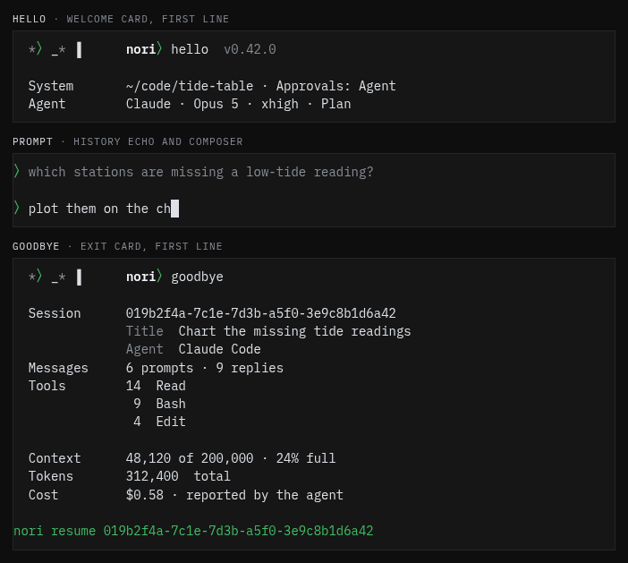
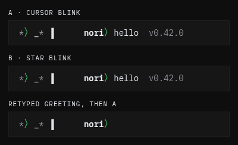
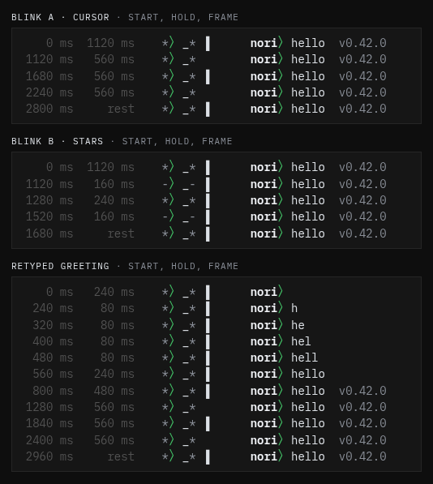

# Nori CLI brand marks: study 01

Design study only. Nothing here changes product code. All content is synthetic.

Open `index.html` for a controllable preview (mode, speed, step, glyph fallback,
column count, cell grid). `frames.txt` holds the same frames as plain text.

## Fixed inputs

- The face is `*〉_* ▐`, kept literally: both stars, the space, and the half block.
- `〉` is U+3009 RIGHT ANGLE BRACKET. The prompt and both wordmarks use it.

## Proposal

| Surface | Mark | Notes |
|---|---|---|
| Welcome card, first line | `*〉_* ▐      nori〉hello  v0.42.0` | Face in the label column, wordmark in the value column (col 15). |
| Composer and history echo | `〉text` | No space after `〉`. See cell widths. |
| Exit card, first line | `*〉_* ▐      nori〉goodbye` | Static. The process is exiting. |

Colour uses the terminal's own palette: `〉` is ANSI green everywhere, `nori` is
bold, stars and version are dim, the rest is default foreground. The exit card's
resume command stays green.

## Cell widths

`〉` is East Asian Wide: it takes 2 cells, and fonts draw it in the left cell.
The right cell is blank.

- The face is always 7 cells. Every animation frame changes glyphs in place.
- `〉text` occupies the same 2 cells as today's `› `, so the text column does not move.
- Fallback when a font or terminal cannot draw it: `> ` (2 cells) and `|` for `▐`.
  All alignment is unchanged. See `img/surfaces-fallback.png`.
- Risk: Ghostty Web has rendered CJK glyphs as blank cells. Verify with a text
  capture there before choosing a default.

## Motion

One tick is 80 ms. Motion never delays or moves the card content below the first line.

- **Still.** The rest frame. Also the static alternative: not a TTY, `TERM=dumb`,
  CI, replayed history, or animation turned off.
- **Blink A, cursor.** `▐` goes off and on twice (560 ms each), then rests.
- **Blink B, stars.** Both `*` become `-` for 160 ms, twice, then rest.
- **Retyped greeting (optional).** `hello` is typed at one letter per tick after
  `nori〉`, the version appears, then blink A. Under 3 s. The cursor stays solid
  while typing.
- Every sequence ends on the still frame. A key press jumps to it.
- The exit card does not animate.

## References

| Source | Design choice carried over |
|---|---|
| Jiro character README, monorepo `docs/design/jiro/README.md` | The face is monospace text. Only one part acts at a time. Idle blinks the cursor twice in a long loop. |
| Jiro hello, wink, goodbye emoji, monorepo `docs/design/jiro/exports/emoji/` | Closed eye is `-`. Hello and goodbye are the same face with one small gesture. |
| Nori design specimen v3, monorepo `docs/design/nori-design-specimen-v3.html` | The prompt is the logo. Cursor blink 1.1 s with `steps(1)`. Actors change cells; nothing glides. Green only points. |
| https://noriagentic.com homepage | The hero shows a real command at a prompt. The brand speaks in commands. |
| `nori-logo-opening.mp4`, monorepo `site-noriagentic/assets/video/` | Two parts meet in under 1 s, then the mark holds still. |
| CLI welcome and status cards, `nori-rs/tui/src/nori/session_header/` | One green glyph. Labels at col 2, values at col 15. |
| Exit card study, branch `design/exit-card` | Same grid as the welcome card. Ends on one green action. |
| cli-spinners, https://github.com/sindresorhus/cli-spinners/blob/main/spinners.json | Frames are equal-width strings. 80 ms is the most common interval (34 of 90 spinners). |
| xterm manual, https://invisible-island.net/xterm/manpage/xterm.html (`cursorOnTime` 600, `cursorOffTime` 300) and DECSCUSR in https://invisible-island.net/xterm/ctlseqs/ctlseqs.html | A cursor blink is a hard on/off near half a second. The user's real cursor style is theirs; the mark draws its own `▐`. |

## Open

- Blink A or B.
- Whether `〉text` or `〉 text` reads better in real terminals.
- Larger animations, first-run onboarding, and upgrade sequences are separate studies.
