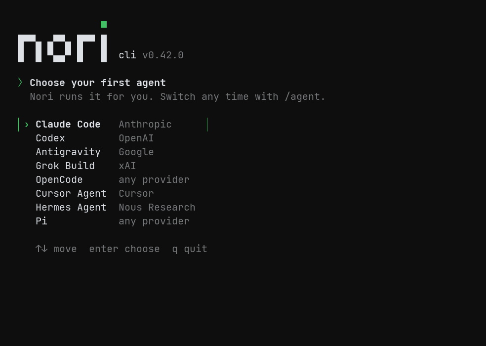
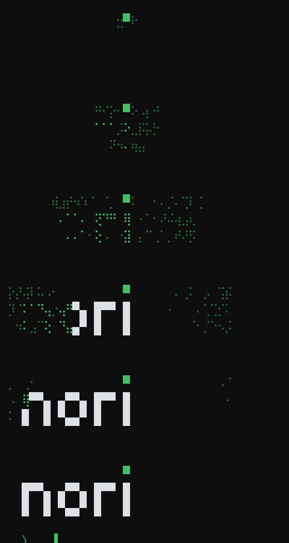
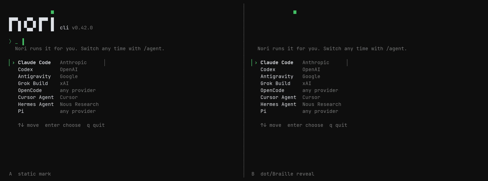
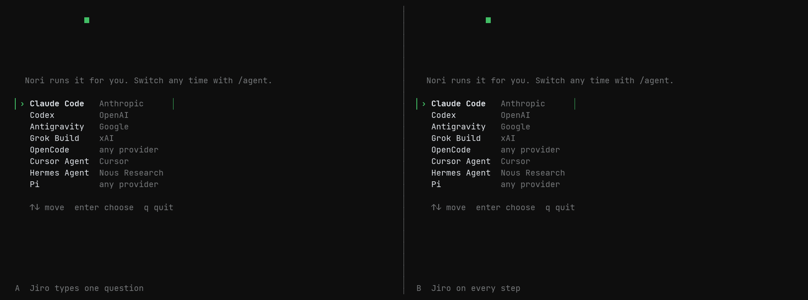

# First-launch onboarding

Design study only. Nothing here changes product code. All content is synthetic
(the project `~/tidepool`, the version `v0.42.0`).

Status: **pending Cliff's choice** of treatment. The Slack thread is
C0CJSCNNE7N/1795798821.649259.



## The screen

First launch opens straight on **Choose your first agent**, with the setup
questions following it. There is no separate welcome page.

1. Choose your first agent: Claude Code, Codex, Antigravity, Grok Build, OpenCode,
   Cursor Agent, Hermes Agent, Pi.
2. Work in `<folder>`? (trust). Shown only when today's trust rule asks.
3. Compact tool output? Shown only when today's rule asks. Esc skips it.

Every option list takes keys from the first frame. Neither motion element
blocks or delays input.

## Wordmark

Three rows of half blocks, which give six square pixel rows. The i dot sits
alone on the top pixel row so it can be green.

```
              ▀
█▀▀▄ ▄▀▀▄ █▀▀ █
█  █ ▀▄▄▀ █   █  cli v0.42.0
```

- Letters use the default foreground. The i dot is ANSI green, the same green as
  the face. `cli` uses the default foreground; the version is dim.
- It is 15 cells wide, or 29 with `cli v…` beside it.
- Size rules:

  | Terminal | Header |
  |---|---|
  | at least 31 columns and 18 rows | big mark with `cli v…` on the baseline |
  | 18–30 columns, at least 18 rows | big mark, with `cli v…` on its own line underneath |
  | anything smaller | the one-line `〉nori CLI v…` wordmark from #801 |

- The lowercase, heavy, tight-set word follows the website wordmark. The
  letterforms here are drawn fresh for the cell grid. The website's i has no
  green dot; the green dot is new here.

## Motion

### Mark reveal (optional)

- Runs for 720 ms inside a fixed 3 × 31 cell box around the mark. Nothing
  outside the box changes.
- A front spreads from the green i dot, which is visible from the first frame.
  Distance is aspect-corrected, so one row counts as two columns.
- Letter cells first show Braille dust drawn from their own half-block pixels,
  thresholded with a 4×4 Bayer matrix. Each cell then locks to its block glyph
  at a slightly jittered time.
- Cells outside the letters show sparse dim green Braille, thin out to `·`, and
  clear.
- Frames come every 40 ms (25 fps). The reveal is a pure function of elapsed
  time, so stills can be taken at exact times.



### Jiro typing a question

This reuses the #801 face, `〉_ ▐`, all green.

- The face opens for 200 ms.
- The mouth `_` then types the title at 30 ms per letter, pushing the right eye
  along (`〉Choose y_ ▐`).
- It holds for 240 ms, then settles to `〉 Choose your first agent`, with the
  title in bold. `〉` is the composer prompt glyph.
- On later steps (variant B only) the face first blinks once (B3, 80 ms per
  frame).
- With the reveal on, typing of the first title starts at 480 ms, so the two
  overlap.

### Variants compared

| | Mark | Jiro |
|---|---|---|
| A | static | types only "Choose your first agent" |
| B | reveal | types only "Choose your first agent" (recommended) |
| C | reveal | blinks and types every step's title (about 1.3 s per step) |




### Static and reduced motion

With `[tui] animations = false`, every frame is the settled frame. Production
should also show the settled frame when stdout is not a TTY or `TERM=dumb`.
`NO_COLOR` removes color but keeps the layout.

## Responsiveness

**Measured** with `prototype --bench` (ratatui 0.30, release, one core of an
EPYC 9654). Each figure covers widget render, ratatui buffer diff, and
crossterm encoding, with no terminal I/O. Raw data is in `data/bench.csv`.

| Size | reveal + typing p95 | static + typing p95 | settled p95 | bytes/frame (reveal / static) |
|---|---|---|---|---|
| 40x16 | 13 µs | 13 µs | 13 µs | 47 / 46 |
| 80x24 | 28 µs | 24 µs | 24 µs | 106 / 46 |
| 120x40 | 52 µs | 52 µs | 52 µs | 106 / 46 |
| 200x60 | 112 µs | 110 µs | 110 µs | 106 / 46 |

- Cost scales with the screen area (ratatui's diff), not with the reveal.
- **Live run:** interactive in tmux at 80x24, recorded by asciinema. The draws
  took p50 58 µs and p95 73 µs. Keys pressed at 264 ms and 517 ms, during the
  reveal, were handled and flushed 50–71 µs after they were read. Raw data is in
  `data/live-tmux-trace.txt`.
- **Not measured:** how fast the terminal emulator paints, and the frame rate it
  actually displays.
- **Estimate:** production adds one `schedule_frame_in` per 40 ms frame for
  about 1.3 s, and then nothing.

## Reuse

- **From nori-cli #629** (`MotionBackground`):
  - Braille bit packing (`BITS`)
  - the 4×4 Bayer matrix
  - `smooth` and `hash`
  - the deterministic-time approach (`--at-ms` stills)

  These are about 30 lines and are private today, so production should expose
  them from `nori-tui-components` rather than copy them.
- **Not reused from #629:**
  - The full-screen field. It costs about 1 µs per cell in Braille phases
    (#629 report: 4.4 ms p95 at 120x40).
  - `MotionPalette::nori()` RGB colors. The TUI's clippy config forbids
    `Color::Rgb`; this study uses ANSI green plus DIM.
- **From #801:** the face glyphs, the B3 blink, and the 30 ms letter timing. The
  `StartupFace` typing is hard-wired to `nori CLI`. A shared "face types a
  string" timeline would serve both the startup header and onboarding.
- **Future scope:** optional `nori cloud` onboarding subcommands. The website's
  full-screen zoom and formations may belong there.

## Known gaps

- Short terminals cut the agent list. Production uses the scrolling selector.
- `▀ ▄ █` are East Asian Ambiguous width. A terminal set to draw ambiguous
  characters wide will misalign the mark, so treat it like the `▁` note in #801.
- Braille needs a font that covers it. Some font and terminal pairs leave gaps
  between cells. This only affects the 720 ms reveal, never the settled frame.
- The picker does not yet show which agents are installed or signed in.

## Reproduce

```sh
cd docs/design/first-launch-onboarding/prototype
CARGO_TARGET_DIR=/tmp/obtarget cargo build --release
B=/tmp/obtarget/release/onboarding-study
$B                                   # interactive; --mark static|reveal --flow one|sparse
$B --bench                           # frame costs
$B --cast cmp.cast --compare marks --keys "300:down,600:down" --until 2600
bash ../scripts/render.sh gif cmp.cast cmp.gif
bash ../scripts/render.sh still cmp.cast cmp.png 0.3
```

Rendering needs `agg` (built from source), ImageMagick, JetBrains Mono,
DejaVu Sans (for Braille), and Noto Sans Mono CJK JP (for `〉`).
