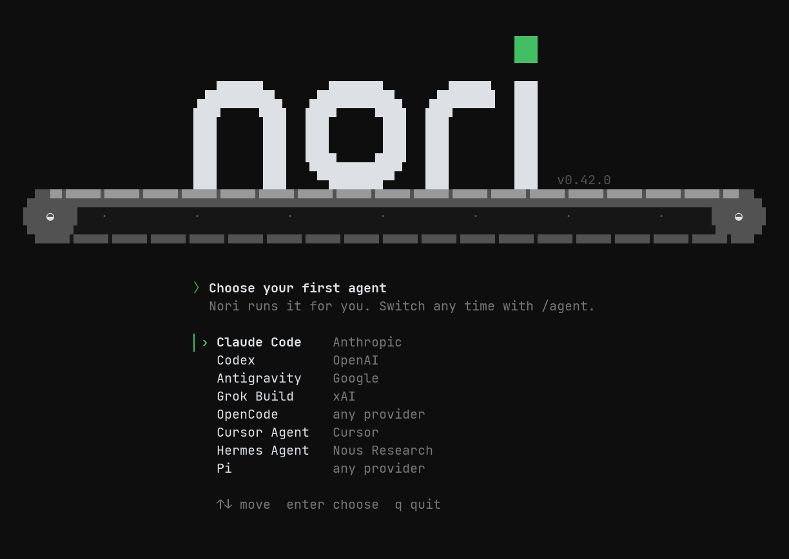

# conveyor

A kaiten-style belt runs across the header. Large lowercase `nori` letters ride
in from the right, the belt slows and stops with the word in place, the treads
overshoot and settle, and the green i dot drops on last.

## Timeline (pure function of elapsed ms)

| ms | What happens |
|---|---|
| 0–700 | Belt at cruise speed. Treads (top run left, return run right) and rotating roller hubs read as motion; letters enter at the screen edge one by one. |
| 700–2000 | Constant deceleration; the letters stop at their settled column. |
| 2000–2320 | Treads overshoot by 1.5 columns and spring back. |
| 2080–2450 | The green dot falls onto the i, bounces once by half a row. |
| 2480 | Settled hero frame; nothing moves after this. |

- Letters are drawn as rounded shapes sampled on a quadrant grid (half a cell
  each way), so the belt and letters move in half-column steps.
- ANSI 16 only: letters bold default fg, plate tops DIM, belt DarkGray, rail
  Black, dot Green. Version `v0.42.0` rides on the belt behind the i.

## Notes

- Keypress: any key snaps to the settled frame and goes to the menu, which takes
  keys from frame one (`--key MS` simulates this; see `casts/conveyor-key-at-800ms.cast`).
- Static / reduced motion: draw the settled frame (`img/still.png`) directly.
- Narrow (< 64 cols or < 26 rows): a 3-row compact version, the two-row half-block
  mark on a one-row belt, same motion ([still-narrow](img/still-narrow.png)).

## Next

- Letterforms are geometric and steppy at this size; corners need hand-tuning.
- The roller hubs (`◐◒◑◓`) are small; a bigger drawn spoke would read better.
- The compact mark's i dot touches its stem; give it its own row if rows allow.

Build: `CARGO_TARGET_DIR=/tmp/motiftarget cargo build --release -j 2`, then
`motif-conveyor --cast out.cast [--size WxH] [--until MS] [--key MS]`.
