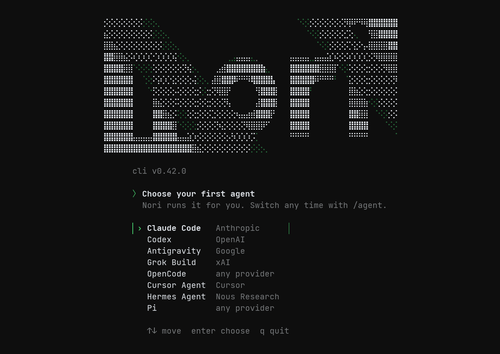
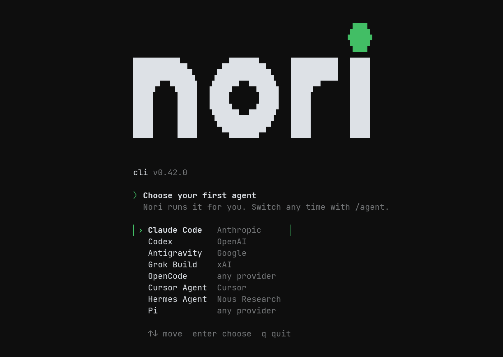
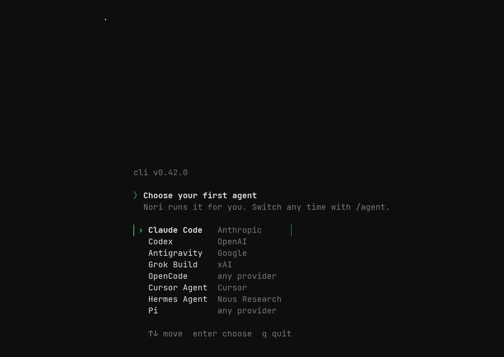

# moire

Two fine line gratings, sampled at Braille resolution (2x4 dots per cell), drift
over each other inside a 60x12 cell box; grating B is shifted half a period
inside the letters of `nori`, so the word exists only in their XOR. As the
angles converge, broad interference bands sweep across and the word shimmers in
and out, sometimes positive, sometimes negative; then both gratings snap equal,
the background cancels to empty, and `nori` locks solid and resolves to blocks.

  

## Timeline (2.3 s, then static)

| ms | |
|---|---|
| 0–320 | the box fades in from empty (fixed noise rank), gratings 9° apart |
| 0–1900 | angle gap eases 9° → 1.4°, pitch gap → 0, B drifts one period; bands widen and slow; word most legible ~1300–1880 |
| 1900 | snap: same angle and pitch; background empties, word is solid Braille |
| 1980–2300 | letters lock whole to quadrant blocks: i (dot turns green), r, o, n |

- Grating lock angle 45°, pitch 2√2 dots with a 1/8-period offset: at the lock
  every dot centre sits a quarter stripe from an edge, so the carrier samples
  as clean 2-on/2-off diagonals instead of boundary-flicker checkerboard.
- Tone per cell follows the smooth XOR coverage: BOLD, default, DIM green, DIM.

## Notes

- Keypress mid-animation: input is live from frame 0 (menu drawn throughout);
  any key jumps the box straight to the settled frame.
- Static / reduced motion: the settled block wordmark (`--static`).
- Narrow (< 64 cols or < 26 rows): skip the box and draw the existing 3-row
  half-block mark or one-line `〉nori CLI`; the moiré needs ~60 columns to read.
- Next: the quadrant letterforms are coarse (1x2-dot pixels make tall stairs on
  the n shoulder and o); consider keeping the solid-Braille letters as the final
  state or drawing a dedicated block font. The 0–700 ms frames are busy carrier
  texture; a quieter opening would help. A soft-edge vignette read as noise.

Cast: `motif-moire --cast moire.cast --until 2700`; GIF via agg with
`--last-frame-duration 1` (render.sh's 2 s tail would exceed 4 s).
