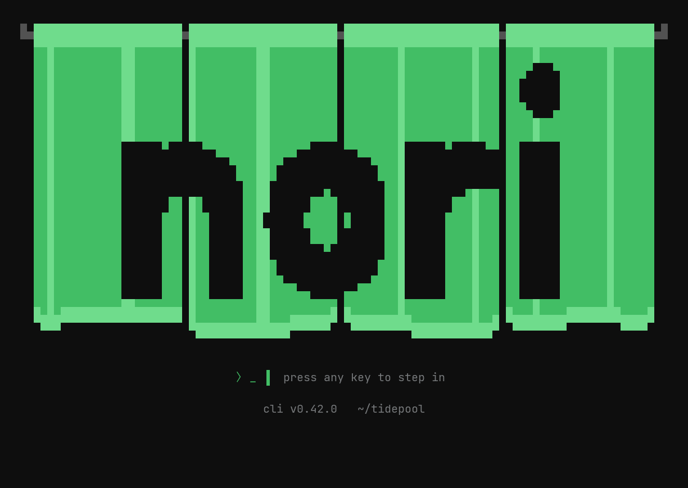
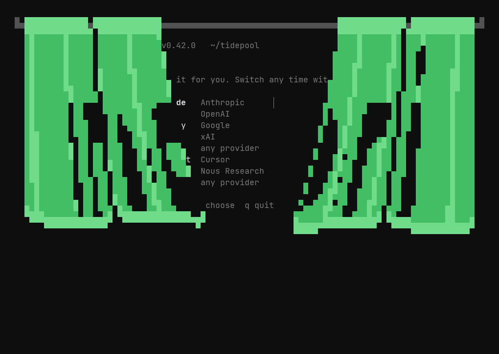

# Motif: noren

Setup opens behind a four-panel shop curtain hung from a rod across the top
two-thirds of the terminal, with a heavy rounded `nori` knocked out of green
cloth and split by the slits. A key parts the panels to the edges, where they
bunch, sway once and stay as a frame around the first setup question.

 

Also: `img/motion.gif` (100x30, key at 0.8 s), `img/flick.gif` (everyday
startup), `img/still-narrow.png` (40x16).

## Timeline (first launch)

- 0–0.8 s: closed; the hem ripples in a faint breeze. Below it: `〉_ ▐ press any key to step in`.
- 0.8 s key: the rod end moves first and deeper cloth lags (130 ms at the hem), so
  panels skew; letters squeeze and the print turns into the crowding folds; the hem lifts.
- ~1.6 s: panels reach the edges; the hem overshoots and swings back once.
- 1.3–2.1 s: Jiro types "Choose your first agent"; still by ~2.6 s.

## Everyday startup (`img/flick.gif`)

No idle, no prompt: the curtain starts opening at t=0 at twice the speed with
almost no sway (~0.4 s); the chat is drawn and live behind it from frame one.

## Notes

- Keypress: the question is live from frame one; the first key parts the curtain and,
  if it is a menu key, also acts on the menu; a key mid-parting snaps to the settled frame.
- Static / reduced motion: the settled frame (panels bunched at the edges), no ripple.
- Narrow: the curtain scales (letters are SDFs), so 40x16 still reads `nori`; below
  ~36 columns a real version would use the one-line `〉 nori CLI` header.
- Colors: ANSI 16 only (Green cloth, LightGreen sleeve/hem/fold crests, DarkGray rod);
  letters are the terminal background, so they invert on light themes. `--letters white`
  gives white-on-green dyeing instead.

## Next

- Fold crests read as straight pillars on the hero; try fewer, tapered ones, or none.
- The hem ripple is quantized to half rows, so it steps rather than flows.
- Settled bunches use ~16 columns per side; at 80 columns they should fold away.
- Build: `CARGO_TARGET_DIR=/tmp/motiftarget cargo build --release`, then
  `motif-noren --cast cast/motion.cast --until 3600` (`--flick`, `--size 40x16`).
