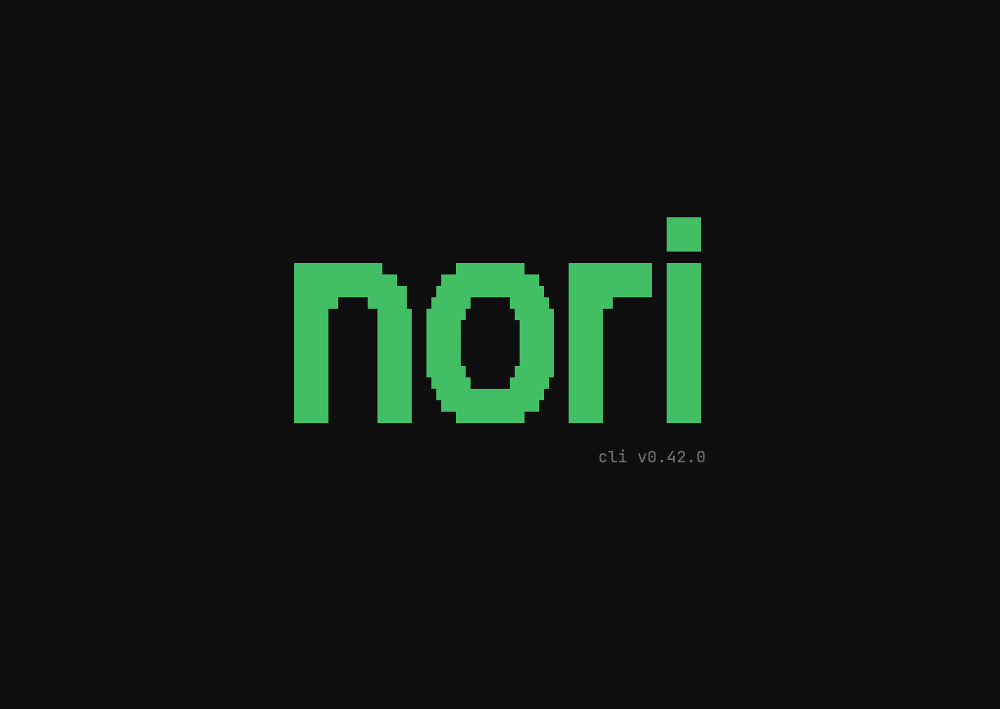
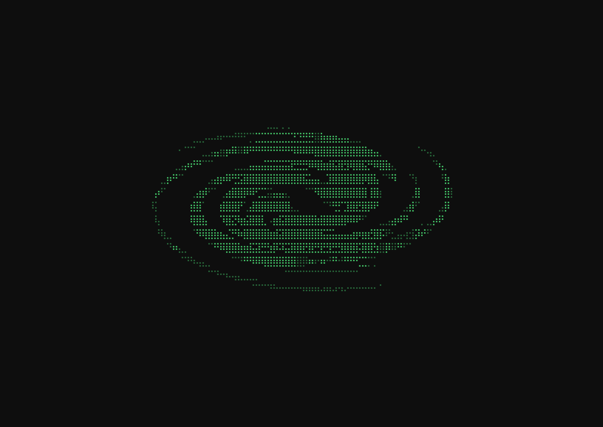

# unmixing

The `nori` wordmark is dye in glycerin: a laminar annular shear winds it into a
spiral galaxy, holds, then runs the same map backwards so every dot lands where
it started (the Taylor–Couette "unmixing" demo). Not a fade: one pure function
of a shear amount `s`, and `s` returns to exactly 0 (asserted).

 

Strip (0.2, 0.55, 0.75, 0.95, 1.6, 2.6, 3.1 s): `img/strip.png`. Motion: `img/motion.gif`.

## How it works

- Letters: superellipse shapes, 9 sub-particles per Braille dot (dots are square).
- Each particle turns by `s · 1.6 turns · (1 − r/R)` on an ellipse squashed to 0.42.
- At `s = 0` cells draw as solid quadrant blocks; while moving they draw as
  Braille. Cells with ≤ 3 lit dots, or mostly half-empty dots, are DIM (thin dye).
- ANSI green, DIM, and default foreground only. No 256-color or RGB.

## Timeline (25 fps, 3.2 s)
| ms | |
|---|---|
| 0–300 | crisp mark, `cli v0.42.0` dim under the right edge |
| 300–1350 | stir (quintic ease): italic lean, then arms, then a galaxy |
| 1350–1750 | hold at maximum smear |
| 1750–2800 | exact reverse |
| 2800– | crisp, version back, stop |

## Notes
- Keypress: any key jumps `s` to 0 (settled frame) and is handled normally; the menu is live from frame one.
- Static / reduced motion: the settled crisp frame (`--static`).
- Narrow (< 50 cols or < 14 rows): skip the motif and show the one-line `〉nori CLI v…` wordmark; the big mark is 48 cells wide.

## Next

- The block→Braille switch on the first moving frame is a visible snap; try a softer hand-off.
- Letterforms are first pass (square n shoulder, flat r arm).

Build with `CARGO_TARGET_DIR=/tmp/motiftarget cargo build --release -j 2`; run `--cast FILE` or `--text MS`.
