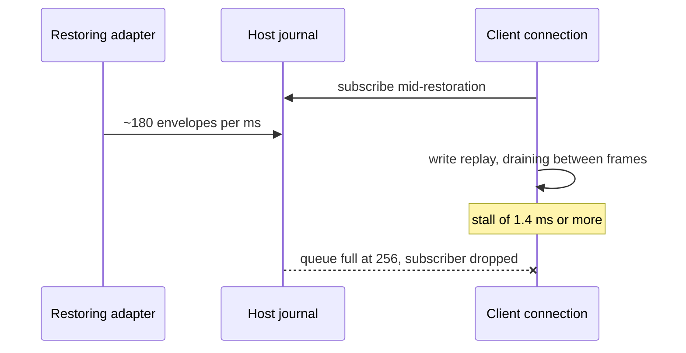

# #769 residual recovery disconnect: cause and repair

All sessions, adapters and content are synthetic (the "kiln" agent from the independent acceptance harness, and the `scripts/attach_perf` fixture in #770).

| Build | SHA |
|---|---|
| Repair, #769 head | `085dac66de3db2caab042679679812cc4d69dacb` |
| Previous #769 head | `e2e98ba32dcad099615d3ec9a37a0019982c1a5d` |
| #772 head, #769's parent | `d8c061dad6a77651d25d118c9a1f6dcf172d7ac4` |
| Shipped baseline | `nori-v0.30.0-next.6` release tarball (musl) |

Linux x86-64 on Modal, 4 vCPU, kernel 7.3.4, tmux 3.3a. Rust 1.90.0 glibc release builds, each revision in its own `CARGO_TARGET_DIR`. Binary hashes are in `SHA256SUMS`.

## Cause

`diag/diag.patch` is temporary logging (not committed to any PR) on top of `e2e98ba3`. It records the connection loop and every journal subscriber drop. It ran in three parallel recovery loops (`stress/hunt.py`, 240 recoveries), and 12 recoveries showed "Connection lost". `diag/hostdiag.log` shows the same sequence in all 12:

1. The client subscribes while the replacement adapter is still restoring: the replay holds 1,941–2,472 of about 2,815 envelopes.
2. 1.4–5 ms into the replay write, the journal drops the subscriber with `full=true`, even though the backlog drained the live queue between frames.
3. The connection then sees its subscription close and ends.

Restoration published 256 envelopes in about 1.4 ms. A 256-event live queue therefore tolerated only about 1.4 ms without draining. Any longer gap between two drains overflowed it, during the replay or after it. The log does not show which frame write stalled, and the replay loop drains only after each write completes. All 12 drops came before the replay ended, so the earlier hypothesis that a burst after the replay fills the queue does not explain these cases.



## Repair

`085dac66` sizes a host subscription's queue to the journal's retention (4,096 by default). A reconnect could not replay a larger gap anyway, so a client further behind is still dropped. Tokio allocates the queue as it fills. The replay backlog from `e2e98ba3` is unchanged. `harness/tests/managed_remote.rs::a_subscriber_may_pause_until_it_is_one_journal_behind` fails on `e2e98ba3` ("the paused subscriber was dropped") and passes on the repair. It also checks that a subscriber more than one journal behind is closed.

## Results

| Same stress, 3 parallel loops × 80, alternating transcript and native load | Recoveries with "Connection lost" |
|---|---:|
| Repair `085dac66` (`stress/stress-new-*.log`) | **0 / 240** |
| Previous head `e2e98ba3` (`stress/stress-old-*.log`) | **10 / 240** |
| Previous head with diagnostic logging (`diag/hunt-diag-*.log`) | 12 / 240 |

| #770 `recovery.py --audit-all`, 128 and 160 sections, 8 per size and mode | Outcome |
|---|---|
| Repair (`measure/long-new.json`) | 32 pass |
| Previous head (`measure/long-oldfix.json`) | 31 pass, 1 `notice_in_history` (160, native) |
| #772 parent, 160 transcript (`measure/long-parent.json`) | 3 pass |

- 150-section open (`measure/open150.json`, n=3 per build): repair 48–63 ms with no disconnect; previous head 60–65 ms; #772 16.7 s, with disconnect notices in every sample.
- 64-section opening (`measure/replay-*.json`, median of 5): Enter to latest reply 51.8 ms on the repair, 741 ms on #772, 1,249 ms on next.6; 16 draws against 662 and 661.
- Wire order (`measure/wire.json`): 339/339 ordered events on #772 and on the repair.
- Recovery bound (`measure/limit-*.json`): all 8 samples at 200 sections (2,003 updates) passed. "Replay unavailable" appeared at 216 sections and at every size from 225. Sizes 213 and 220 passed once each. Both histories share the 4,096-envelope journal. The limit predates #769.
- No sample ended with the probe prompt unsent in the composer (0 of 67 audited long-fixture samples).

## Not covered

- macOS and fat-LTO builds were not rerun for the repair.
- With the repair, a client that stops reading can hold up to 4,096 queued envelopes plus 4,096 in the replay backlog. Before, the queue held 256.
- `tui-pty-e2e` `ctrl_d_in_the_list_closes_a_session_and_frees_its_slot` failed once in CI on `085dac66` and once locally under heavy load. It passed 18 of 18 unloaded local runs and also failed in CI on the unrelated `47eb27e4` (run 45564221866), so it is treated as a pre-existing load-sensitive flake.

## Reproduce

`stress/hunt.py` imports `kiln.py` and `replay769.py` from `harness/perf/` on `nori/host-tui-acceptance-769-0e673ef4` at `9185ef94`. Place it beside that `harness/` directory.

```sh
./stress.sh new /path/to/nori-085dac66 80
./stress.sh old /path/to/nori-e2e98ba3 80
python3 scripts/attach_perf/recovery.py "$BIN" --samples 8 --turns 128 160 --audit-all --output long.json
```
