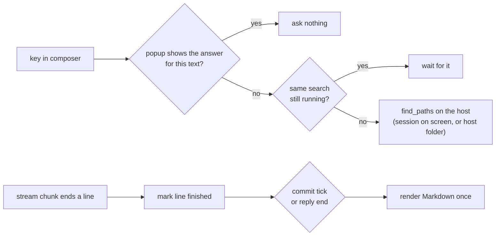

# #791 at 27ccdfda: `@` answers a reopened search, and replies render once per tick

All data is synthetic. Builds: same-machine Linux release (`line-tables-only`), each in its own target dir.

- `l3-trace-27ccdfda.md`: the `@` trace on the final head, with separate host and client homes, read off the wire through `relay.py`. Every step is answered from the folder of the session on screen, or from the host's folder when no session is selected. No client file appears.
- `l3-trace.md`: fc7324c2 next to this change. The only difference is "same text again", which fc7324c2 never sent, leaving the popup on `loading...`.
- `replay-compare-linux-release.json`: `joined_open.py`, median of 3, at 64/150/170 sections:

| build | newest reply ms |
|---|---|
| pre-cutover dfd9b4d4 (`nori attach` before the joined client) | 56 / 53 / 59 |
| base 66264b5d | 227 / 802 / 957 |
| fc7324c2 | 110 / 166 / 183 |
| 27ccdfda | 93 / 131 / 148 |

After Ctrl+L, every section mark printed exactly once, in order, in 9/9 runs, with plan updates interleaved. The key typed 50 ms after launch showed up in 54–66 ms in every build.

- `live-lines-27ccdfda.json`: a live multi-line stream (`live_probe.py`). Each line appears within one 50 ms tick of being sent, as on fc7324c2, and the trailing partial line stays hidden until the reply ends. After Ctrl+L, each line appears once.
- Profile: `perf record -e cpu-clock` with `perfwrap.sh` attached to the attach client, summarized by `attribute.py`. On fc7324c2, re-rendering Markdown on each chunk was the largest bucket, about 500 samples per 3 runs at 170 sections. At this head it is about 20.
- Residual: newest reply still grows about 0.3 ms per section, against about 0.03 ms before the cutover. Each reply is still rendered twice, at finalize and again as the merged Markdown cell in the full-screen view, and both renders run syntect. The skills scan of each tool snapshot and allocation account for the rest. Removing the second render changes the cell type the Ctrl+L and merge paths depend on, so it is left as a follow-up.
