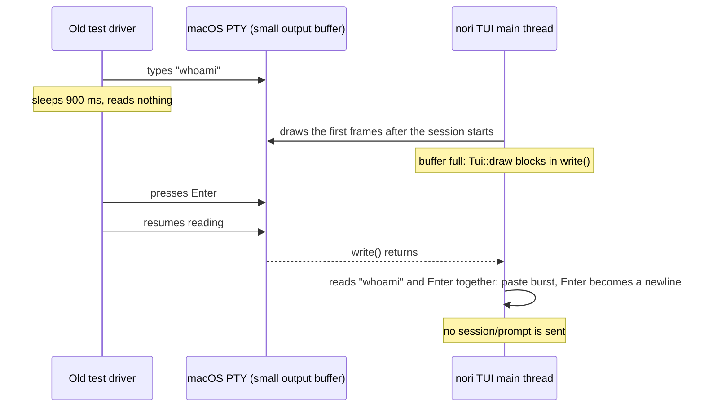

# #750 at `54b4ca5c`: independent verdict

**Pass.** The native startup loss came from the test driver, not from the TUI.
`54b4ca5c` changes only test files; the product code is byte-identical to
`32471d77`.

## How the loss happens

A terminal that keeps reading never fills the buffer, so the TUI stays
responsive and Enter submits.

## Native macOS A/B on one build (run 45398909781, job "macOS driver A-B")

Verifier-only branch `verify/pr-750-54b4ca5c-native-drain` (`2806af08`).
`PTY_DRIVER` switches only the pauses that `54b4ca5c` changed. `sleep` is the
`32471d77` driver, `drain` is the `54b4ca5c` driver, and `human` sends one key
every 70 ms and presses Enter 250 ms later while reading continuously. The
suites are `host_startup`, `host_new_session`, `host_session_picker` and
`host_agent_switch`. The rounds interleave the drivers, and the `nori` and
`nori-tui` SHA-256 hashes are the same before and after.

| Driver | Rounds | Tests passed | Failed |
|---|---|---|---|
| sleep (old) | 12 | 224 | 4: `startup_activates_its_session_through_the_owned_host` in rounds 2, 7 and 11; `input_typed_right_after_new_goes_to_the_new_session` in round 12 |
| drain (`54b4ca5c`) | 12 | 228 | 0 |
| human | 6 | 114 | 0 |

- **Every failure has the original symptom.** The host received
  `prepare_agent → session/list → session/new`, `› whoami` stays in the
  composer with the cursor on the row below, and no `session/prompt` is sent.
  See `native/sleep-round2-failure.txt` and
  `native/old-driver-failure-screen.png`.
- **Stack samples** (`/usr/bin/sample` 400 ms into the pause, rounds 1 and 2):
  - In the failing round-2 run, the main thread was in
    `Tui::draw → CrosstermBackend::show_cursor → Stdout::flush → write`
    (`native/sample-round2-failing-blocked-in-write.txt`).
  - In the passing round-1 run of the same test, it was idle in
    `__psynch_cvwait` (`native/sample-round1-passing-idle.txt`).
  - Across all 89 samples, 6 caught a blocked `write()` and the rest show an
    idle event loop. One of the 6 is in `/new`
    (`native/sample-new-session-blocked-in-write.txt`).
- **The `/new` test failed the same way under the old driver.** That test
  comes from #749, so the stall is not specific to the startup path.
- **Sleep against drain plus the exact head:** 4/228 failed against 0/418.
  One-sided Fisher p = 0.015.
- **Unread-byte probe:** FIONREAD on the macOS PTY master always reads 0, so
  it gives no signal there. On Linux the old driver leaves only 120–531 bytes
  unread, and the count stays flat during the pause. That is far below the
  Linux PTY capacity, which is why Linux never reproduced the loss
  (`native/linux-sleep-unread-bytes.txt`).

## Exact head `54b4ca5c`, unpatched (same run, job "macOS exact head")

| Suite | Passed | Failed |
|---|---|---|
| tui-pty-e2e | 86 | 0 (2 ignored) |
| nori-tui | 1824 | 0 |
| nori-harness | 501 | 0 |
| nori-acp-host | 144 | 0 |
| nori-cli | 265 | 0 |
| nori-config, nori-host-runtime, nori-auth-providers | 220, 9, 66 | 0 |
| 4 host suites × 10 rounds | 190 | 0 |

The implementer's pinned native run 45397667088 and Linux CI 45397126155 also
passed.

## Linux, the same patched build locally

5 rounds per driver: sleep 95/95, drain 95/95, human 95/95.

Terminal scenarios through tmux, which always reads: S33c–f, S34a–m, S36 and
S36b at `54b4ca5c` are in `results/54b4ca5c-s34/`.

## Behaviour confirmed under drain and human typing (native and Linux)

- **Startup:** a prompt typed while the agent prepares is sent once, to the
  startup session (`a_prompt_typed_while_the_agent_prepares_reaches_the_startup_session_once`).
  So are a positional prompt and a prompt typed during `/resume`.
- **`/new`:** input typed right after `/new` goes only to the new session
  (`input_typed_right_after_new_goes_to_the_new_session`, S33c and S33e).
- **Refusal:** the held prompt is not sent and returns to the composer. Enter
  then sends it once (`a_refused_new_session_returns_the_held_input_without_sending_it`,
  `a_positional_prompt_whose_session_is_refused_returns_to_the_composer_unsent`,
  S33d, S33f, S34f and S34g).

## Correction to the earlier re-check (issuecomment-7131872666)

The earlier re-check said the loss would also hit users. That is withdrawn for
responsive terminals.

- **When it can still happen:** the loss needs the terminal to stop reading
  the TUI's output for the whole time between the last key and Enter. That
  requires a frozen or back-pressured terminal.
- **Who handles keys that arrive in one burst:** the existing paste-burst
  logic, as it did before this stack. Nothing in #750 changes it.
- **Answer to the open question (why no tick flushed the burst):** the main
  thread was blocked in `write()`.

All homes, adapters and prompts are synthetic.
