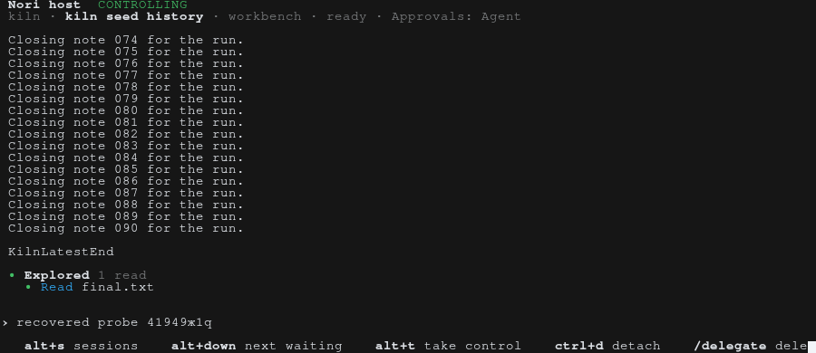
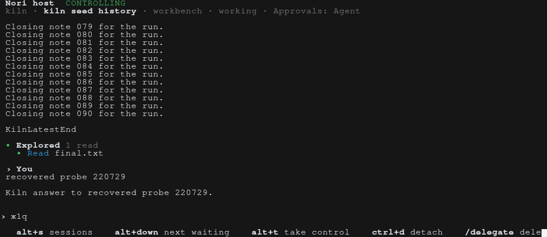
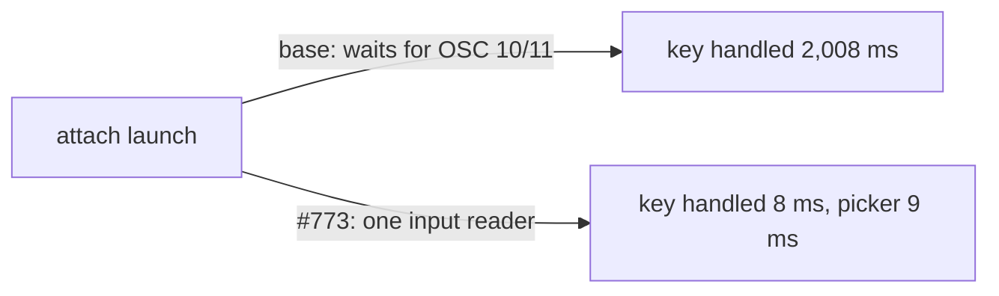

# Independent recheck: #769 residual recovery at 085dac66, #770 at 5705df90, #773 smoke at d3165b1c

All sessions, agents and content are synthetic (the kiln agent in `harness/perf/`, and #770's `scripts/attach_perf` fixture). No feature branch was edited.

| | SHA |
|---|---|
| #769 head (tested fix) | `085dac66de3db2caab042679679812cc4d69dacb` |
| Failing control (previous #769 head, the fix's parent) | `e2e98ba32dcad099615d3ec9a37a0019982c1a5d` |
| #772 head (#769 base, long-open reference) | `d8c061dad6a77651d25d118c9a1f6dcf172d7ac4` |
| #770 head (`nori-rs/` tree identical to 085dac66) | `5705df90a331297a6ae03888adca78e245ddccea` |
| #773 head (parent is 5705df90) | `d3165b1cf608a9f36805c16f5143546f749ddfaf` |
| macOS workflow commit | `f88d34a0` on `verify/pr-769-085dac66-native-perf`, run 45635046105 |

Heads were checked again before publishing; none moved. Handoff comments: #769 issuecomment-7164923854, #770 issuecomment-7164924617.

Builds: `cargo build --release --locked -p nori-cli`, Rust 1.90.0, glibc on Linux (Modal, kernel 7.3.4, tmux 3.3a) and native on macOS 15.7.4 arm64 (6-vCPU Blacksmith runner). Each revision has its own `CARGO_TARGET_DIR`. Hashes: `linux/SHA256SUMS`, `macos/stress/SHA256SUMS`.

## Verdict

- **#769 at 085dac66: residual F1 is fixed. No blocker.**
  - The deterministic regression fails on the control and passes on the fix, on both platforms.
  - In the same Linux stress, the control showed the disconnect notice in 4 of 156 recoveries, and in one of those the next prompt was not sent. The fix had 0 of 156.
  - Every fix sample restored the history exactly once and in order, and the replacement agent answered the new prompt.
- **#770 at 5705df90: the labelled `--audit-all` recovery check works and reproduces from a clean checkout.** At 32 samples it doesn't separate the fix from the control: both passed 32 of 32. Use the parallel stress to compare builds.
- **#773 at d3165b1c, on its final base: the smoke check passes.**
  - Without a color reply, the first key in the attach picker was handled at about 8 ms, against 2,008 ms on the base.
  - The picker was populated by about 9 ms.
  - Opening a session afterwards worked in every sample.

## #769: deterministic paused-subscriber regression

`harness/tests/managed_remote.rs::a_subscriber_may_pause_until_it_is_one_journal_behind`, run alone, repeatedly. The control gets only the new test file (`git status` recorded per tree).

| | Linux | macOS |
|---|---:|---:|
| Fix 085dac66 | 20/20 pass | 10/10 pass |
| Control e2e98ba3 | 20/20 fail, "the paused subscriber was dropped" | 10/10 fail, same message |
| Whole `managed_remote` file, fix | 12/12 | 12/12 |
| Whole file, control | 11/12 (only the new test fails) | — |

Gotcha: the fixture's `mock-model` agent needs `mock_acp_agent` built in the same target dir. Without it, every test in the file times out at setup on both trees. The first Linux attempt hit this and is discarded.

## #769: failed-session recovery in draining terminals

`harness/perf/stress769.py`: kill the adapter, Ctrl+R, open, send a prompt only the replacement can answer, then rebuild and audit the whole scrollback from PageUp captures. Builds alternate per attempt, and transcript and native restoration alternate every two attempts. Three loops run in parallel. Labels: `pass`, `notice_in_history`, `history_mismatch`, `prompt_lost`, `replay_unavailable`, and the inconclusive `unsent_draft` and `error`.

| Kiln fixture (sections ≈ updates) | Fix 085dac66 | Control e2e98ba3 |
|---|---|---|
| Linux, 64 (≈1,396), 3 × 40 per build | **120 pass** | 118 pass, **2 `notice_in_history`** |
| Linux, 85 (≈1,840), 3 × 12 per build | **36 pass** | 34 pass, **2 `notice_in_history`** |
| macOS, 64, 3 × 16 per build | 48 pass | 48 pass |
| Inconclusive (`unsent_draft` / `error`) in-bounds | 0 | 0 |

- **What the control's failures look like** (`linux/stress/failures/`):
  - "Connection lost. Reconnecting… host connection closed" appears inside the restored history, after sections 44, 49, 55 and 85.
  - The notice splits a reply. For example, ``glaze `celadon-`` / notice / ``49` held.`` (`captures/ctl-e2e98ba3-split-scrollback.txt`).
  - When it reconnects, the latest reply arrives about 800 ms later.
  - In one native sample the next prompt never left the composer.
  - No history was lost or duplicated in any of these samples.
- **Latency is unchanged.** Median from Enter to the latest reply: fix 73.1 ms, control 73.4 ms on Linux at 64 sections, and 45.9 against 44.8 ms on macOS. Median from Enter to the new answer: about 300 ms on Linux and 255 ms on macOS for both builds.
- **macOS still doesn't reproduce F1 on the control**, as in the previous round. There it confirms correctness, timing and the deterministic test, not the stress difference.

| Control, prompt never sent | Fix, prompt answered |
|---|---|
|  |  |

## #770: labelled recovery audit at 5705df90, from a clean checkout

- **Unit tests:** `python3 -m unittest discover -s scripts/attach_perf` passed 19 of 19.
- **Recovery audit:** `recovery.py --samples 8 --turns 128 160 --audit-all` on Linux; 4 samples per size on macOS.

| | Linux | macOS |
|---|---|---|
| Fix | 32/32 pass | 16/16 pass |
| Control | 32/32 pass | 16/16 pass |

- **It doesn't separate the builds here.** The serial audit runs without load, and the control fails at about 2.6% even under parallel load, so 32 samples are expected to catch at most about one failure.
- **The documented command only shows F1 when run longer or under load**, for example in three parallel loops.
- **No inconclusive outcomes:** no `unsent_draft` and no `error`.

## Long open (normal, not recovery), unloaded

150 kiln sections (≈3,225 updates), median from Enter to the latest reply:

| | Linux | macOS |
|---|---:|---:|
| Fix | 76.3 ms (n=3), plus 69.9 in the parent run | 41.7 ms (n=3) |
| Control | 75.5 ms (n=3) | 40.6 ms (n=3) |
| #772 parent | 22,695 ms (n=1), 10 disconnect notices | not run |

Every open sample was exactly once and in order, with 0 disconnect notices on the fix and the control.

## Retained-history boundary (separate from F1, predates #769)

The host journal keeps 4,096 envelopes.

- **Opening a session** has a sharp limit:
  - 170 sections (≈3,650 updates): 87 ms.
  - 185 sections (≈3,970 updates): 91 ms.
  - 190 and 200 sections: "Replay unavailable: cursor … has expired". The client keeps the existing conversation.
- **Recovery** keeps the old and the restored history in the same journal, so its limit is lower and depends on timing (fix only):

| Recovery size | Passed |
|---|---|
| Kiln 90, 100, 110 | 6/6 |
| Kiln 120 | 1/4 |
| Kiln 130 | 1/4 |
| Kiln 140 | 3/4 |
| Kiln 160 | 0/12 (Linux 0/8, macOS 0/4; the control is the same) |
| #770 fixture, 200 turns | 4/4 |
| #770 fixture, 216 turns | 2/4 |
| #770 fixture, 225 turns | 2/4: native 2/2, transcript 0/2 |

- **Correction to the handoff:** it says every size from 225 turns shows "Replay unavailable", but native restoration passed at 225 here.
- **Where the limit sits:** recovery is reliable up to about 2,000–2,400 updates. Above that, the result depends on how much of the old history is still in the journal.

## #773 smoke on its final base (Linux)

| Attach picker, launch → typed key rendered / picker populated (median, n=5) | Base 085dac66 | #773 d3165b1c |
|---|---:|---:|
| Colors answered immediately | 8.0 / 9.2 ms | 7.8 / 9.2 ms |
| Colors after 150 ms | 310.0 / 311.3 ms | 7.9 / 9.2 ms |
| No color reply | 2,008.2 / 2,009.6 ms | 7.8 / 9.2 ms |

- **Probe:** `harness/perf/palette773.py`, independent of the PR's script. It uses a raw controlling PTY with echo off, and answers the cursor, status and device-attribute queries.
- **Every sample opened the saved session and exited 0** (30/30).
- **The PR's own `measure.py --check`** for attach, resume and host-ls, n=3, agreed:
  - With no color reply, the attach picker took 2,008.6 ms on the base and 8.5 ms on #773.
  - Resume took 2,086.7 ms and 102.4 ms.
  - `host ls` took 2,007.9 ms and 8.1 ms.
- **Unconfirmed, low:** resume with immediate colors measured 85.0 ms on the base and 95.9 ms on #773 (n=3). The PR's own table shows no difference.

## Residual risks and gaps

- **Memory:** with the fix, a client that stops reading can hold up to 4,096 queued envelopes plus the 4,096-envelope replay backlog. Before, the queue held 256. This round didn't measure memory.
- **macOS can't show the F1 difference under load,** because the control doesn't fail there.
- **No fat-LTO build** was used in this round.
