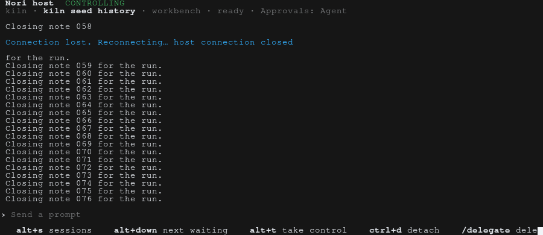
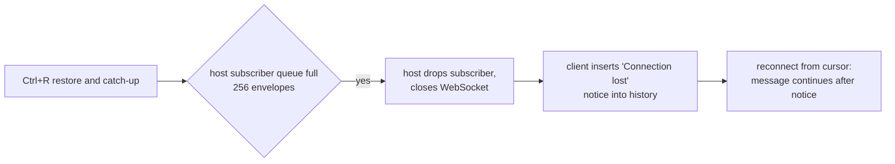

# #769 / #770 independent verification

| | SHA |
|---|---|
| #769 fix head tested | `0e673ef45839e9809b8e7c5d2734d90d1780bbd7` |
| #770 benchmark head tested | `789a2ce53f5082553395ce75813ec248934e429c` |
| Baseline (main as specified) | `8099204975768d0b0d17e7bd21f13cfbd48ddb59` |
| main at report time | `eda83aae7` (docs rewrite and host lifecycle #764–#767; #769 is now CONFLICTING because #762 deleted `nori-rs/tui/src/attach/docs.md`) |

Builds: `cargo build --release --locked -p nori-cli` (fat LTO, one codegen unit, stripped), Rust 1.90.0, glibc targets.
Each build had its own target directory. Sharing one target dir between worktrees gave a stale, identical binary because of the repo's `--remap-path-prefix`.

| Platform | base binary | fix binary |
|---|---|---|
| Linux x86-64 (Modal, kernel 7.3.4, tmux 3.3a) | `62552646…` | `f5a12c07…` |
| macOS 15 arm64 (Blacksmith 6 vCPU, [run 45578437762](https://github.com/tilework-tech/nori-cli/actions/runs/45578437762)) | `671aa52a…` | `bceb111c…` |

## Verdict

**#769: the performance claim holds on Linux and native macOS. The open path is correct. One medium finding (F1) is still open in failed-session recovery.**
The PR also needs a rebase onto current main, then a light recheck.

**#770: the benchmark reproduces, including on macOS. Its absolute Linux baseline depends on the build, and its recovery audit cannot detect F1.**

## Method (independent of #770)

`harness/perf/` uses its own synthetic ACP agent (`kiln_agent.py`): 164, 1,396 and 3,225 ACP updates for 4, 64 and 150 sections. Each section has a Markdown heading, a table, a list, alternating Python/Rust fences, a plan every fifth section and a read tool with three output lines. History ends with a 90-line final reply and a final tool. Every run uses a fresh home and a real `nori host`. `nori attach` runs in a private tmux server that drains the PTY, at 100×30 (one matrix at 160×50 with 24 filler rows filtered by `/`). Base and fix samples alternate in order.

For each sample the harness:

- times Enter to first content, the latest reply, the final tool and a live reply injected after first content;
- types a draft (`ж1`) during catch-up and a second character (`ж2`) during a 30-chunk paced stream;
- measures a settled keystroke and PageUp;
- rebuilds the entire scrollback by stitching pages exactly 10 rows apart, and requires every element once and in order: opening marker, all section marks, the summary, all 90 notes, the latest marker, the final tool, then the live replies (and the post-recovery answer).

Duplicated, missing, split or reordered rows all fail this check.

## Linux results (median, min–max in ms; full tables in `linux/SUMMARY.md`)

| 100×30, n=5 per build unless noted | base 80992049 | fix 0e673ef4 |
|---|---:|---:|
| 64 sections: Enter → latest reply | 3,030 (3,022–3,042) | 29.8 (27.3–54.2) |
| 64: Enter → final tool | 3,033 | 29.8 |
| 64: Enter → live reply | 3,064 | 55.8 |
| 64: Enter → first content | 8.7 (7.2–13.0) | 14.2 (8.8–16.0) |
| 64: draft typed during catch-up visible | 13.2 | 16.3 |
| 64: key during paced stream | 27.2 | 13.4 |
| 64: settled key | 21.3 | 13.8 |
| 64: first PageUp | 7.5 | 3.0 |
| 64: frames during catch-up | 1,419 | 30 |
| 64, 24 rows, 160×50 (n=1/2): Enter → latest | 3,173 | 45.3 |
| 150 sections (n=3): Enter → latest | 15,620 (15,563–15,628) | 59.5 (58.3–61.8) |
| 150: PageUp, last 5 at the start of history | 13.6 | 13.6 |
| 4 sections (n=3): Enter → latest | 68.7 | 46.5 |

- Every open sample on both builds kept the full scrollback exactly once and in order, including the live replies and the stream. Base and fix produced the same stitched scrollback SHA and the same settled screen SHA at every size. The draft line was `› ж1ж2q` every time.
- Base at 150 sections disconnected during catch-up in 3/3 opens and left a "Connection lost" row in history. The fix had 0/3.
- Deep scrolling (the fix lays out history from newest to oldest up to the scroll offset) costs the same as base at the start of a 150-section history.

## Failed-session recovery (Ctrl+R → ready → Enter → new answered prompt), Linux, 64 sections

| | base | fix |
|---|---:|---:|
| Ctrl+R → ready row, transcript / native | 36 / 54 | 35 / 52 |
| Enter → latest restored reply, no disconnect | 3,029 | 54 |
| Enter → new answered prompt, no disconnect | 6,150 | 280 |
| Replacement adapter answered the new prompt | all | all |
| Samples with a disconnect during catch-up | 0/19 | **5/21** (+1/11 in the capture loop) |
| Samples whose post-recovery prompt was lost to a disconnect | **2/21** | 0/21 |

Both restore modes show the effect: transcript 3/12 and native 2/9 on the fix. #770's own `recovery.py` on the fix: 6/6 passed with no event gaps. It does not look for this symptom.

### F1 (medium): on the fix, recovery catch-up can be cut by a host disconnect, leaving a notice in the middle of a restored reply



In 6 of 32 fix recovery attempts, the restored history got `Connection lost. Reconnecting… host connection closed` between two chunks of one message. Text was split (`Closing note 031 for the r` / notice / `un.`). Once, a Markdown table was rendered as raw pipes. Reconnecting adds about 750 ms (Enter → latest about 800 ms). No content is lost or duplicated after reconnecting.

Cause, from code: the host gives each live subscription a 256-envelope queue (`harness/src/managed_remote.rs:21`). It drops a subscriber whose queue is full (`harness/src/session_manager/replay.rs:174`). The WebSocket transport then closes the connection (`acp-host/src/remote/host_wire.rs`, the `event = … subscription.events.recv()` arm). The client turns that into a transcript notice (`tui/src/attach/runtime.rs:333`). This host behavior is identical in base, fix and current main.

The fix changes when the drop happens. In base it happened late: 2/21 recovery samples lost the user's next prompt ("A previous request may have reached the host…"), and 150-section opens disconnected 3/3. On the fix it happens during catch-up after Ctrl+R. I have not proven which burst fills the queue at that moment.

Recommendation: #769's owner should root-cause the timing and fix it in #769 or a linked host PR. Options include not dropping subscribers on a transient burst, or never putting connection notices inside a streaming message. Cliff decides whether F1 blocks #769.



## Native macOS (exact-head workflow `verify/pr-769-0e673ef4-native-perf` at `37473fe3`)

| 100×30 | base | fix |
|---|---:|---:|
| 64 sections (n=3): Enter → latest | 2,977 (2,822–2,999) | 28.2 (28.2–34.8) |
| 64: Enter → first content | 9.8 | 17.0 |
| 64: key during stream / settled key | 32.7 / 29.2 | 18.8 / 23.8 |
| 64: frames during catch-up | 1,420 | 28 |
| 4 sections (n=2): Enter → latest | 70.3 | 22.9 |
| Recovery transcript (n=2): Enter → latest / new answer | 2,984 / 6,088 | 43.9 / 263 |
| Recovery native (n=2): Enter → latest / new answer | 2,995 / 5,983 | 44.4 / 256 |

- On macOS, base and fix gave the same scrollback SHA as on Linux (`be5a43f2…` for 64 sections, `e4dcc528…` for 4). That shows rendering is identical across platforms.
- All macOS samples were in order exactly once. No macOS sample had a disconnect, but n=4 is too small to rule out F1.
- `cargo test -p nori-tui --lib attach::` at the fix head on macOS: 135 passed, 0 failed.
- #770 scripts on macOS:
  - `replay.py` on its 64-section fixture: base 718 ms → fix 18 ms to the latest reply, 663 → 16 draws, same settled body.
  - `transport.py`: base and fix both reselected at cursor 339 of 339, with no out-of-order events.
  - Live reply visible and ready: 235 → 19 ms.
- Linux and macOS absolutes differ (base CPU cost, PTY and tmux overheads). Compare the ratio within each platform, not the Linux numbers.

## #770 scripts rerun on my Linux builds

| #770 fixture, 64 sections, n=5 | base (glibc) | fix (glibc) | #770 published (musl) base → fix |
|---|---:|---:|---:|
| Enter → latest reply | 708 (704–710) | 20.4 (19.1–55.1) | 2,562 → 57 |
| Enter → live reply | 725 | 53.5 | 2,623 → 61 |
| Enter → first content | 8.8 | 12.1 | 14.3 → 34.6 |
| Settled key / PageUp / key during stream | 6.3 / 6.3 / 6.5 | 2.9 / 2.9 / 3.0 | 15.4 / 15.3 / 15.5 → 5.7 / 5.9 / 5.8 |
| Draws during replay | 662 | 17 | 663 → 17 |

- The audit run (`--audit`) recovered all 64 sections on both builds. Both settled 120×40 screens are byte-identical to #770's published `verified-screen-64.txt` (SHA-256 `6d8a0f27…`).
- `transport.py`: 339/339 on both builds, cursor 339 on reselect, live reply visible and ready 224 → 52 ms.
- #764 startup gate (fix as head, base twice as control, 20 samples): every median passed on the first run, but first-frame, first-input and cold-host p95 missed their ceilings by 1–3 ms. On an immediate repeat all 8 checks passed. The fix touches none of those paths, so I count the misses as noise, the same pattern #770 recorded. The absolute first input on this machine is about 92 ms, against 39 ms in #770.
- Activation probe (`startup.py`, 10 samples): first handled input 94.2 → 91.2 ms, model visible 110.9 → 109.5 ms, prompt delivered on screen 114.2 → 113.2 ms. The 5-sample run showed the opposite sign, so I count it as noise.

### #770 findings

- **B1 (minor, docs):** the Linux baseline depends on the build. On glibc optimized builds the same fixture costs 708 ms on base, not 2.56 s. The README pins musl. Say that the absolute numbers are musl-specific; the shipped Linux artifact is musl.
- **B2 (minor):** `recovery.py`'s audit allows the largest visible index to reset and stops at the first opening marker it finds. It does not look for connection notices. It would pass F1 and would miss a second copy of the history. A stitched, exactly-once check catches both.
- **B3 (limit, pre-existing):** the host keeps 4,096 envelopes (`harness/src/session_manager/mod.rs:212`). A history beyond that (my 256-section fixture, 5,494 ACP updates) opens as "Replay unavailable: cursor … has expired" with an empty conversation, on base and fix alike. Verified long histories here: 1,396 updates (64 sections) and 3,225 (150 sections) for mine, 643 for #770's.

## Other observations

- First identifiable content arrives later on the fix: about +5 ms on Linux, +7 ms on macOS, +3 ms with #770's fixture. #770 discloses this. It is minor next to the gain to the latest reply.
- Pre-existing, identical on both builds: the scroll offset is unbounded. After 5 PageUps past the start, 7 PageDowns were needed before the view moved. Low severity.
- Not exercised end to end: the permission-prompt answer grace during a replay batch. It is covered by #769's unit tests, which passed on macOS.
- Linux PR CI for `0e673ef4` ([run 45573585163](https://github.com/tilework-tech/nori-cli/actions/runs/45573585163)): 3,433 passed, 0 failed, 15 ignored across 116 suites. #770 CI at `789a2ce5` is green.

## Reproduce

```sh
# binaries from each checkout, separate CARGO_TARGET_DIR per revision
python3 -I harness/perf/replay769.py --build base $BASE --build fix $FIX --sections 64 --samples 5 --out open-64.json
python3 -I harness/perf/replay769.py --build base $BASE --build fix $FIX --mode recover [--native] --sections 64 --samples 6 --keep-scrollback --out recover.json
python3 -I harness/perf/summarize.py *.json
```

`harness/perf/run_linux*.sh` hold the exact matrix. The macOS job is `.github/workflows/verify-769-native-perf.yml` on the verify branch.
