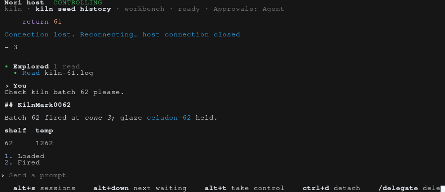
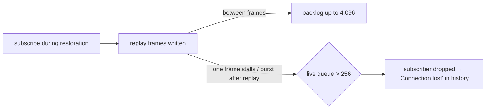

# #769 F1 / #770 B1–B3 recheck

| | SHA |
|---|---|
| #769 head tested (unchanged at report time) | `e2e98ba32dcad099615d3ec9a37a0019982c1a5d` |
| #770 head tested (unchanged at report time) | `588423e7a7111f0bd669cbea93ddf82ef5731922` |
| Former #769 head, F1 control | `0e673ef45839e9809b8e7c5d2734d90d1780bbd7` |
| Stack parent of #769 (#772 head), 256-event queue without #769 | `d8c061dad6a77651d25d118c9a1f6dcf172d7ac4` |
| Main as first specified, prior lost-prompt case | `8099204975768d0b0d17e7bd21f13cfbd48ddb59` |
| Shipped musl baseline (B1) | `nori-v0.30.0-next.6` tarball, SHA-256 `5d0c8907…` (matches README) |

Builds: `cargo build --release --locked -p nori-cli`, Rust 1.90.0, glibc, one `CARGO_TARGET_DIR` per revision. Binary SHA-256 values are in `linux/SHA256SUMS` and `macos/kiln/SHA256SUMS`.
Linux: Modal x86-64, kernel 7.3.4, tmux 3.3a. macOS: Blacksmith macOS 15 arm64, 6 vCPU, workflow `verify/pr-769-e2e98ba3-native-perf` at `88411bff`, [run 45596467150](https://github.com/tilework-tech/nori-cli/actions/runs/45596467150).

## Verdict

**#769: F1 is much rarer but not gone. The host change works for the long-replay drop and the lost prompt. A residual disconnect still splits restored history in about 2% of Linux recoveries.**

**#770: B1–B3 are addressed in the docs. The new audit catches F1, but only with fixtures longer than its documented 64-section default. README absolutes do not reproduce on a clean checkout.**

## F1: failed-session recovery (Ctrl+R → ready → Enter → new prompt answered)

Harness: `harness/perf/replay769.py --mode recover` (own synthetic agent, 100×30, private draining tmux, stitched exactly-once scrollback). Each sample also submits a new prompt and requires the replacement adapter to answer it.

| Linux, 64 sections (1,396 updates) | n | Disconnect notice left in restored history | New prompt lost | Enter → latest reply (median ms) | Enter → new answer |
|---|---:|---:|---:|---:|---:|
| fix `e2e98ba3` | 84 | **1** | 0 | 34–65 | 252–285 |
| fix `e2e98ba3`, real-terminal capture loop | 3 | **1** | 0 | — | — |
| former head `0e673ef4` | 24 | 3 | 0 | about 40 (about 820 with a disconnect) | — |
| parent `d8c061da` | 24 | 0 | **8** | 3,255 | 6,583 |
| main `80992049` | 20 | 0 | **8** | 3,234 | 6,575 |

| Linux, 85 sections (about 1,850 updates) | n | Notice in history | Prompt lost |
|---|---:|---:|---:|
| fix | 4 | 0 | 0 |
| former head | 4 | 4 | 1 |

- Fix: every sample on the fix put history, the draft, and the new answer in order exactly once. The new prompt was answered in 88 of 88 samples (two in the capture loop are not counted).
- Residual F1: one matrix sample (transcript fallback, index 11) and capture-loop attempt 3 both show `Connection lost. Reconnecting… host connection closed` inside restored history, plus about 770 ms to reconnect. Nothing was lost or duplicated. In the capture, the split falls inside a Python fence: `return 61 * 3` renders as `return 61`, then the notice, then a bullet `- 3`.



- Lost prompt (former base case): reproduced on main and on the parent with the same symptom: "Connection restored. A previous request may have reached the host and was not retried". The fix had 0 in 88.
- Large history (open, 150 sections, 3,225 updates, n=3): fix 55.6 ms vs parent 16,701 ms to the latest reply. Fix 0/3 disconnects, parent 3/3, and both were exactly once and in order. macOS (n=2): 48 ms vs 15,673 ms, fix 0/2 and parent 2/2.
- Recovery bound: recovering a 150-section history shows "Replay unavailable: cursor … has expired" on the fix. The original and restored histories both stay in the 4,096-envelope journal, so recovery is limited to about half the open limit (about 2,000 updates). This is pre-existing and not caused by #769.

### Native macOS

| macOS, 64 sections, n=8 per build per mode | fix | former head | parent |
|---|---:|---:|---:|
| Transcript: Enter → latest / new answer (ms) | 41 / 252 | 42 / 263 | 2,700 / 5,471 |
| Native load: Enter → latest / new answer (ms) | 43 / 256 | 40 / 263 | 2,703 / 5,549 |
| Disconnect or lost prompt | 0/16 | 0/16 | 0/16 |

All three builds were exactly once and in order, and the new prompt was answered 48/48. On this 6-vCPU Mac, neither F1 nor the lost prompt appears even on the controls, so macOS shows only correctness and timing for recovery, not the F1 fix. The 150-section open is the macOS case that separates the builds. Unit tests at the fix head: `nori-acp-host --test subscription_replay` 1/1, `nori-tui --lib attach::` 138/138.
#770 `recovery.py` on macOS: 12/12 passed for the fix and 12/12 for the former head. The former head never failed there.

### Likely cause of the residual (from code, not proven)

`host_wire.rs` moves live events into the backlog only between replay frames, and stops draining once the replay is written. If one `send_frame` stalls while the client is busy rendering, or a restoration burst arrives after the replay, more than 256 events can still reach the subscriber queue. `replay.rs:174` then drops the subscriber, as before. The residual notices fall near the end of catch-up (sections 61 and 63 of 64), which fits a late burst.



Linux PR CI at `e2e98ba3` ([run 45590523147](https://github.com/tilework-tech/nori-cli/actions/runs/45590523147)): 3,492 passed, 0 failed, 15 ignored across 118 suites.

## #770 at 588423e7

All commands ran from a fresh clone at the head with a clean tree (`/tmp/clean770.*`).

| Finding | Status |
|---|---|
| B1: absolute baseline depends on the build | **Documented** (musl named, glibc rerun quoted). The shipped next.6 musl artifact measured **1,249 ms** median (n=5) from Enter to the latest reply here, not README's 2,581 ms. The fix measured 54.9 ms, and both drew the same body (`ee5a2c42…`). The ratio holds, but the absolute values depend on the machine as well as the libc. |
| B2: recovery audit could not see F1 or a duplicate | **Fixed in logic.** Stitched exactly-once check and notice rejection; 11/11 unit tests pass. In real runs it catches F1: on the former head it failed 3/12 at 128/160 turns, and 1/11 more in the rerun, each with `connection notice in restored history`. With the documented 64-turn fixture, the former head passed **20/20 on Linux and 12/12 on macOS**: that fixture does not produce F1, so the README's recovery command does not exercise it. By default only the first sample of each group is audited. |
| B3: range not stated | **Documented** (4–64 sections; 4,096-envelope retention). Not stated: recovery's lower bound of about 2,000 updates. |

Other #770 observations:

- README results cite `c3e3d4fa` (#769) and `96e84746` (stack). Both are pre-rebase commits; neither is on the current stack. The numbers were not remeasured at `e2e98ba3`. Minor.
- At 160 turns, 1/16 fix runs left `RecoveryProbe` in the composer and never submitted it. There was no notice and no disconnect. It did not recur in 15 reruns, and my harness answered 88/88 on the fix. Unexplained, low confidence; possibly the script's 120 ms paste-burst wait under load.
- Parent at 160 turns failed 2/5 with the old lost prompt; `recovery.py` reports it as a timeout, not a labeled failure.
- The 64-turn audit screen matches the published `verified-screen-64.txt` (`6d8a0f27…`).

## Reproduce

```sh
H="python3 -I harness/perf/replay769.py --build fix $FIX --build oldfix $OLDFIX --build parent $PARENT"
$H --mode recover [--native] --sections 64 --samples 12 --keep-scrollback --out recover.json
python3 -I harness/perf/capture_split.py $FIX capture 60
# #770 detection power (clean clone at 588423e7)
python3 scripts/attach_perf/recovery.py $OLDFIX --samples 1 --turns 160 --modes transcript
```

Run scripts: `harness/perf/run_recheck*.sh`. `linux/aborted/` holds the first matrix, which stopped when the parent's lost prompt broke paging. The harness now records that sample as a failure.
