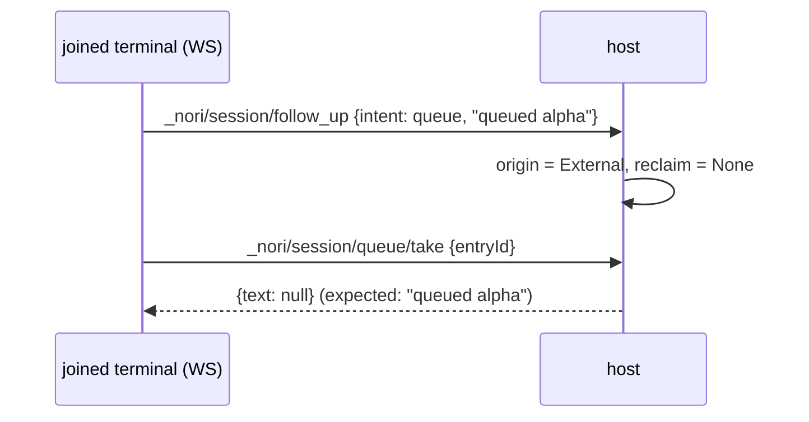

# Independent acceptance: #778 at a2e02a80 (queue recovery from any terminal)

Synthetic data only. Release build of the head; baseline `main` 0466dddf. Wire probes in `harness/feature_probes.py` (`probes.json`), plain `nori` scenarios K01–K04 (`plain-K.json`), and the full matrix (`matrix.json`).

## Verdict: one finding (F1, high), otherwise passes

### F1 (high): a terminal joined over the host connection can never take back a queued prompt, even its own

- Every prompt queued through `_nori/session/follow_up` over the WebSocket is listed with `editable: false`.
- `_nori/session/queue/take` returns `{text: null}` on the first call, including for the connection that queued the prompt.
- Cause: the host records wire follow-ups with `PromptOrigin::External`, and `editable_text` requires the reclaim data that only `LocalComposer` prompts carry. That rule predates this PR (#696); `take` builds on it.
- Effect: the PR's diagram ("terminal B reconnects … take → {text}") can't happen. Neither can the shared attach client's Alt+↑ reclaim, once it joins over the wire.
- Plain `nori` is unaffected: S26b reclaim passes, because its prompts are local.
- Needs an owner decision: should the host remember which connection or terminal composed a prompt, or is take meant to be plain-`nori`-only? If the latter, the PR text overstates it.

## Passes

- The capability is advertised.
- A late watcher sees the paused queue (`paused: interrupted`, three entries in order).
- Watcher take, resume and discard each get `-32016`.
- Resume delivers every queued prompt exactly once, in order (adapter ledger).
- Take after the prompt started returns `null`.
- Discard sends nothing and clears both the queue and the pause.
- An unknown session gets `-32002`.
- Plain `nori` queue S26a/b/c passes.
- Regression: no check changed state against `main` in the full S01–S45 matrix.
