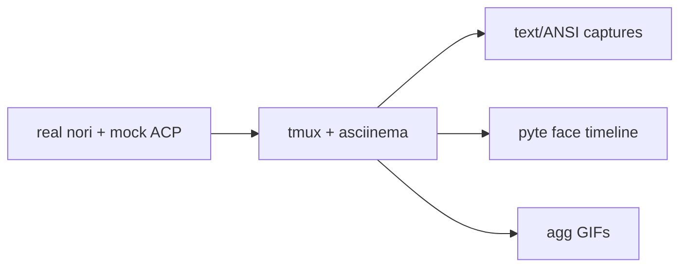

# #801 startup face: independent verification

**Tested SHA:** `6af6b80e434cc8d5c3097561accaa8e8de889d81` (`feat/startup-face-animation`). The comparison base is `f5c0361e2`.
**Verdict:** pass. No blocking findings.

I drove the real debug `nori` against `mock_acp_agent` in tmux and recorded each run with asciinema (`harness/startup-face/`). Each run used a synthetic `tidepool` project under `/tmp/v801` and a private `NORI_HOME`. `timeline.py` replays each cast through pyte and logs every change to the face row with its timestamp and colors (`*/face-timeline.txt`).

| Check | Result | Evidence |
|---|---|---|
| Typing from the first frame | Pass. Text typed the moment the first frame appeared was kept. Backspace, Left and insert edits all worked before readiness. | `s1-delayed/01-first-frame-typed.txt`, `notes.txt` |
| Submit before readiness | Pass. The agent received nothing while `session/new` was gated. After release it received exactly one prompt, still one 3 s later. History shows the prompt once, the reply once, and one wordmark. | `s2-submit-early/notes.txt`, `02-history.txt` |
| Delayed `session/new` (gated, about 10 s) | Pass. The face held open-eyed with no wink, no wordmark and no config row. The wink came 9 ms after the config row was drawn, then the retype ran. History holds one wordmark, one Agent row, no leftover face, and the draft `〉draft tide low tables`. | `s1-delayed/*` |
| Delayed `initialize` (3 s) | Pass. Two blinks, a hold, then the wink at readiness. One wordmark. | `s4-slow-init/*` |
| Fast start | Pass. Readiness arrived before the eyes finished opening. The face jumped open, winked, and retyped. One wordmark. | `s3-fast/*` |
| `initialize` failure | Pass. The face froze open with no wink and no `nori CLI`. The agent picker opens, as on base. After Esc the draft is intact and accepts more typing. | `s5-fail-initialize/02-picker-dismissed.txt` |
| `session/new` failure | Pass. The face froze open immediately, with no wink and no wordmark. The composer kept the draft and accepted more typing. | `s5-fail-new-session/*` |
| Green face, mouth included | Pass. Every face cell is ANSI green (`38;5;2`) in every frame. The wordmark `〉` is green, `nori CLI` is bold in the default foreground, and the version is dim (`SGR 2`). | `face-timeline.txt`, `s3-fast/01-ready.ansi` |
| Blink timing | Pass. Frames are 79–80 ms apart. The eyes stay open 400–401 ms between blinks. Runs showed one blink (s1, s7) or two (s2, s4), all within the 1–3 range. | `face-timeline.txt` |
| Wink and retype | Pass. The wink lasts 237–241 ms. Name and version letters arrive 30 ms apart. | `s1-delayed/face-timeline.txt` |
| `〉` composer prompt | Pass. Submitted messages and list pointers keep `›`. | screen captures |
| `animations = false` | Pass. The static wordmark shows before readiness, with no face. After readiness there is one wordmark and one config row. | `s6-no-animations/*` |
| Narrow terminal (30×20) | Pass. The face holds and the draft wraps. After release there is one wordmark and no leftover face. | `s7-narrow/*` |

GIFs: `s1-delayed/session.gif`, `s2-submit-early/session.gif`, `s5-fail-new-session/session.gif` and `s7-narrow/session.gif`, rendered with `agg --idle-time-limit 1.5`. That limit shortens only the long idle hold.

## Observations (not regressions)
- The 8 s "Connection is taking longer than expected" notice is held back until readiness, so it shows up next to the config row after the connection has already succeeded. Base `f5c0361e2` does the same (`base-f5c0361e-connect-warning.txt`). Because the notice is held, it never freezes the face. It may be worth a separate issue.
- The goodbye card still shows `› Nori CLI`. That card belongs to the separate exit-card design (`design/exit-card`).
- Harness note: keys sent at machine speed trigger the composer's paste-burst handling on both base and PR, which swallows Backspace and Enter. The scripts pace edits by 250 ms, like a person typing.

## Gaps
- I did not exercise Ctrl+T or a resize while waiting, `/screen` before readiness, a short terminal, or ambiguous-width `▁`. The PR's e2e suite covers the first four. I did not rerun that suite; the PR's Linux checks pass at this SHA.
- I ran only the mock agent and a dev build (`v0.0.0`). I did not test real provider adapters or a release build.
- I did not test config changes after readiness (`/config`). Only the initial config row was checked.
